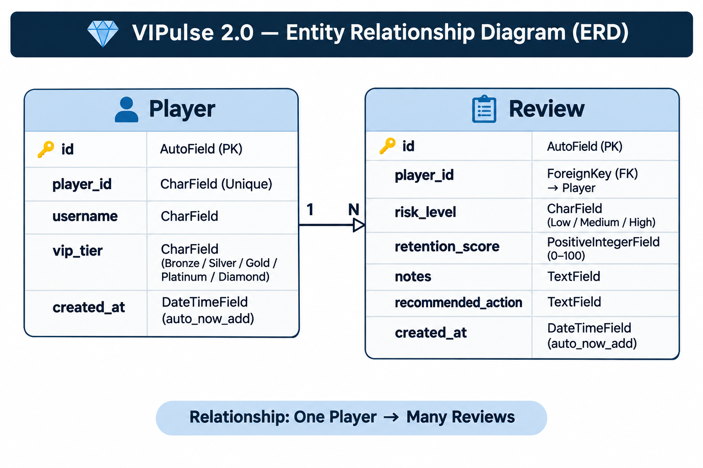

# 💎 VIPulse 2.0

**VIP Player Management and Retention Review System**

VIPulse 2.0 is a full-stack web application developed to help iGaming customer support, VIP management and retention teams organise player information, assess player risk levels and document retention recommendations.

Built using Django and PostgreSQL, the application provides a centralised workspace where authorised users can manage VIP player profiles, create and update player reviews, monitor retention scores and access key operational statistics through a dashboard.

The project focuses on structured record management, clear navigation, responsive design and practical workflows for internal operational teams.

**[Live Application](https://vipulse-2-27dcf5edfa12.herokuapp.com/)** | **[GitHub Repository](https://github.com/Azhdakurt/vipulse-2)**


*VIPulse 2.0 responsive presentation illustrating the application's desktop and mobile layouts.*

---

## Table of Contents

1. [Project Overview](#project-overview)
2. [Project Goals](#project-goals)
3. [Target Audience](#target-audience)
4. [User Stories and MoSCoW Prioritisation](#user-stories-and-moscow-prioritisation)
5. [Agile Methodology](#agile-methodology)
   - [GitHub Projects Kanban Board](#github-projects-kanban-board)
6. [UX Design](#ux-design)
   - [Design Approach](#design-approach)
   - [Wireframes](#wireframes)
   - [Colour Scheme and Typography](#colour-scheme-and-typography)
7. [Features](#features)
   - [Authentication and Access Control](#authentication-and-access-control)
   - [Dashboard](#dashboard)
   - [Player Management](#player-management)
   - [Player Profiles](#player-profiles)
   - [Review Management](#review-management)
   - [Forms and Validation](#forms-and-validation)
8. [Database Design](#database-design)
   - [Entity Relationship Diagram](#entity-relationship-diagram)
   - [Database Models](#database-models)
9. [Technologies Used](#technologies-used)
10. [Testing and Validation](#testing-and-validation)
11. [Deployment](#deployment)
    - [Local Deployment](#local-deployment)
    - [Heroku Deployment](#heroku-deployment)
12. [Bugs and Known Issues](#bugs-and-known-issues)
13. [Credits and Acknowledgements](#credits-and-acknowledgements)
14. [AI Assistance](#ai-assistance)

---

## Project Overview

VIP and retention teams often need to manage player records, review risk indicators and track recommended actions across multiple accounts. Without a structured system, this information can become difficult to organise, retrieve and maintain consistently.

VIPulse 2.0 addresses this challenge by providing a single application for player management and review tracking.

The application allows authenticated staff to:

- Create, view, update and delete VIP player records.
- Search for players using their username or Player ID.
- Filter player records by VIP tier.
- Create, edit and delete player reviews.
- Record risk levels, retention scores, notes and recommended actions.
- Filter reviews by risk level and retention score range.
- View individual player profiles and review histories.
- Monitor player and review statistics through a central dashboard.

VIPulse 2.0 is an internal staff-facing application. Authentication is required to access the dashboard, player records and review management features. Public self-registration is not available.

The application is designed as a portfolio project demonstrating full-stack development, relational database modelling, CRUD functionality, authentication, responsive user interfaces and software testing.

## Project Goals

The primary goals of VIPulse 2.0 are to:

1. Provide a centralised system for managing VIP player information.
2. Support consistent recording and review of player risk and retention assessments.
3. Make player records and review histories easy to search and access.
4. Present key operational information through a clear dashboard.
5. Protect internal application features through user authentication.
6. Deliver a responsive interface that works across different screen sizes.
7. Demonstrate full-stack development using Django and a relational database.

## Target Audience

VIPulse 2.0 is designed for internal operational teams working in the iGaming industry, including:

- **VIP Managers:** To review player profiles, VIP tiers and retention assessments.
- **Customer Support Teams:** To access structured player information and review histories.
- **Retention Teams:** To document retention scores, observations and recommended actions.
- **Team Leaders and Operations Managers:** To monitor player and review activity through the dashboard.

The application is a demonstration system rather than a production gambling platform. It does not process bets, payments or real-money transactions.


## User Stories and MoSCoW Prioritisation

User stories were created to define the application's functional requirements from the perspective of its intended users. Each story describes a specific user need and the value that the corresponding feature should provide.

The project was planned and managed using GitHub Issues and GitHub Projects. Each user story includes acceptance criteria and development tasks to support implementation and testing.

The MoSCoW prioritisation method was used to organise the requirements according to their importance.

- **Must Have:** Essential functionality required for the application to operate effectively.
- **Should Have:** Important functionality that improves the user experience and supports operational workflows.
- **Could Have:** Additional functionality that enhances usability but is not essential to the core application.
- **Won't Have:** Functionality excluded from the current project scope.

### Must Have User Stories

| ID | User Story | GitHub Issue |
| --- | --- | --- |
| US01 | As a registered staff member, I want to log in securely to VIPulse, so that I can access the player management system and manage VIP player information. | [#1 - User Login](https://github.com/Azhdakurt/vipulse-2/issues/1) |
| US02 | As a staff member, I want to view a list of registered VIP players, so that I can access and manage their player information efficiently. | [#2 - View Players](https://github.com/Azhdakurt/vipulse-2/issues/2) |
| US03 | As a staff member, I want to add new VIP players to the system, so that I can maintain accurate player records and manage their VIP information. | [#3 - Add Player](https://github.com/Azhdakurt/vipulse-2/issues/3) |
| US04 | As a staff member, I want to edit existing VIP player information, so that I can keep player records accurate and up to date. | [#4 - Edit Player](https://github.com/Azhdakurt/vipulse-2/issues/4) |
| US05 | As a staff member, I want to delete an existing VIP player record, so that I can remove records that are no longer required and keep the player database accurate. | [#5 - Delete Player](https://github.com/Azhdakurt/vipulse-2/issues/5) |
| US06 | As a VIP team member, I want to create a review for an existing player, so that I can assess their retention status, identify potential risks and recommend appropriate actions. | [#6 - Add Review](https://github.com/Azhdakurt/vipulse-2/issues/6) |
| US07 | As a VIP team member, I want to view all player reviews in one place, so that I can monitor player retention, identify potential risks and review recommended actions. | [#7 - View Reviews](https://github.com/Azhdakurt/vipulse-2/issues/7) |
| US08 | As a VIP team member, I want to edit an existing player review, so that I can update risk assessments, retention scores and recommended actions as a player's circumstances change. | [#8 - Edit Review](https://github.com/Azhdakurt/vipulse-2/issues/8) |
| US09 | As a VIP team member, I want to delete an existing player review, so that I can remove incorrect or unnecessary assessments and maintain accurate review records. | [#9 - Delete Review](https://github.com/Azhdakurt/vipulse-2/issues/9) |
| US10 | As a logged-in staff member, I want to log out securely from VIPulse, so that I can end my session and prevent unauthorised access to player information. | [#10 - User Logout](https://github.com/Azhdakurt/vipulse-2/issues/10) |

### Should Have User Stories

| ID | User Story | GitHub Issue |
| --- | --- | --- |
| US11 | As a VIP team member, I want to search for players by Player ID or username, so that I can quickly locate specific player records without manually browsing the entire player list. | [#11 - Search Players](https://github.com/Azhdakurt/vipulse-2/issues/11) |
| US12 | As a VIP team member, I want to view a dashboard summarising player and retention review data, so that I can quickly understand the VIP portfolio, identify potential risks and make informed retention decisions. | [#12 - View VIP Dashboard](https://github.com/Azhdakurt/vipulse-2/issues/12) |
| US14 | As a VIP team member, I want to view an individual player's profile, including their VIP tier, latest risk level, retention score and review history, so that I can quickly understand their current status and make informed retention decisions. | [#14 - View Individual Player Profile](https://github.com/Azhdakurt/vipulse-2/issues/14) |

### Could Have User Stories

| ID | User Story | GitHub Issue |
| --- | --- | --- |
| US13 | As a VIP team member, I want to filter players by their VIP tier, so that I can quickly identify players within a specific VIP segment and manage them more efficiently. | [#13 - Filter Players by VIP Tier](https://github.com/Azhdakurt/vipulse-2/issues/13) |

### User Story Implementation

All 14 user stories were implemented in VIPulse 2.0.

The completed functionality includes secure authentication, player and review CRUD operations, player searching, VIP tier filtering, dashboard statistics and individual player profiles.

Each GitHub Issue contains its associated acceptance criteria and implementation tasks, providing a record of the requirements and development work.

Functional testing and validation are documented separately in [TESTING.md](TESTING.md).

The user stories were tracked through the project's GitHub Kanban board, which is discussed in the following Agile Methodology section.


## Agile Methodology

VIPulse 2.0 was developed using an Agile approach, with project requirements organised into user stories and tracked through GitHub Projects.

Each user story was documented as a GitHub Issue, including acceptance criteria and development tasks. The MoSCoW prioritisation method was used to distinguish essential functionality from additional improvements.

### GitHub Projects Kanban Board

A GitHub Projects Kanban board was used to organise and monitor development progress.

The board included three workflow stages:

- **To Do:** User stories and tasks awaiting development.
- **In Progress:** Features currently being implemented or tested.
- **Done:** Features that had been completed.


*VIPulse 2.0 Kanban board showing the project's development workflow and user story progress.*

The board can be viewed here:

[View VIPulse 2.0 GitHub Project Board](https://github.com/users/Azhdakurt/projects/5/views/1)

This approach helped organise the development process, prioritise essential functionality and track the implementation of the application's 14 user stories.


## UX Design

VIPulse 2.0 was designed with a focus on clarity, usability and efficient navigation for internal VIP management and retention teams.

The interface aims to make player information and retention assessments easy to access, while keeping common management tasks straightforward.

### Design Approach

The application's design follows several key principles:

- **Clear navigation:** Authenticated users can move between the Dashboard, Players and Reviews sections.
- **Consistent layouts:** Player and review pages use familiar cards, forms and action buttons.
- **Visual hierarchy:** Headings, statistics and status indicators help users identify important information.
- **Responsive design:** Layouts adapt to desktop and mobile screen sizes.
- **Form usability:** Clearly labelled fields and validation messages support accurate data entry.
- **Confirmation before deletion:** Users must confirm destructive actions before records are removed.

Bootstrap 5 was used to support responsive layouts and consistent interface components, alongside custom CSS for the application's visual identity.

### Wireframes

The following wireframes illustrate the page structure, visual hierarchy and responsive layouts of VIPulse 2.0 across desktop and mobile screen sizes.

#### Dashboard Wireframe

The dashboard layout presents key player and review statistics alongside recent VIP review activity.


#### Player Management Wireframe

The player management layout includes player search, VIP tier filtering, player records and management actions.


#### Player Profile Wireframe

The player profile layout brings together individual player details, summary information and historical reviews.


#### Review Management Wireframe

The review management layout provides access to recorded assessments, filtering controls and review management actions.


#### Player Form Wireframe

The player form layout supports both creating and editing player records through a consistent interface.


#### Review Form Wireframe

The review form layout supports entering and updating risk levels, retention scores, notes and recommended actions.


#### Login Wireframe

The login layout provides a simple authentication interface with clearly labelled username and password fields.


### Colour Scheme and Typography

VIPulse 2.0 uses a dark-themed interface to create a consistent visual identity across its pages.

The design uses contrasting text, clearly defined content areas and visual indicators to distinguish navigation, actions and important player information.

Typography and spacing are applied consistently to maintain readability and support a clear information hierarchy.

The interface combines Bootstrap styling with custom CSS to provide a cohesive appearance across desktop and mobile devices.

## Features

VIPulse 2.0 provides a collection of features designed to support VIP player management, retention assessments and day-to-day operational workflows.

All player management, review management and dashboard features require authentication.

### Authentication and Access Control

**Related User Stories:** [US01 - User Login](https://github.com/Azhdakurt/vipulse-2/issues/1) and [US10 - User Logout](https://github.com/Azhdakurt/vipulse-2/issues/10)

VIPulse 2.0 uses Django's built-in authentication system to protect internal player information.

Registered staff members can log in using their username and password. Invalid credentials trigger an error message, while successful authentication allows access to the application's protected pages.

Unauthenticated visitors are redirected to the login page when attempting to access protected functionality.

A logout option allows staff to end their session securely. Once logged out, protected pages cannot be accessed without authenticating again.


### Dashboard

**Related User Story:** [US12 - View VIP Dashboard](https://github.com/Azhdakurt/vipulse-2/issues/12)

The dashboard provides an overview of the VIP player portfolio and recorded retention assessments.

It displays four key statistics:

- **Total VIP Players:** The number of registered players.
- **Total Reviews:** The number of recorded player reviews.
- **High-Risk Players:** The number of distinct players with high-risk reviews.
- **Average Retention Score:** The average retention score across recorded reviews.

The dashboard also includes a **Recent VIP Reviews** section displaying the five most recent assessments.

These statistics are generated dynamically from the database, ensuring that the information reflects the current player and review records.


### Player Management

**Related User Stories:** [US02 - View Players](https://github.com/Azhdakurt/vipulse-2/issues/2), [US03 - Add Player](https://github.com/Azhdakurt/vipulse-2/issues/3), [US04 - Edit Player](https://github.com/Azhdakurt/vipulse-2/issues/4), [US05 - Delete Player](https://github.com/Azhdakurt/vipulse-2/issues/5), [US11 - Search Players](https://github.com/Azhdakurt/vipulse-2/issues/11) and [US13 - Filter Players by VIP Tier](https://github.com/Azhdakurt/vipulse-2/issues/13)

The Players page provides a central location for managing VIP player records.

Each player record displays identifying information, including the Player ID, username and VIP tier.

Staff members can:

- View existing player records.
- Search for players by Player ID or username.
- Filter players by Bronze, Silver, Gold, Platinum or Diamond VIP tier.
- Add new player records.
- Edit existing player information.
- Delete player records following confirmation.
- Open an individual player's profile.

Player information is retrieved dynamically from the database.


#### Adding and Editing Players

The player form allows staff to enter or update the following information:

- Player ID
- Username
- VIP Tier

Required fields are validated before submission, and duplicate Player IDs are rejected.

When editing an existing player, the form is populated with the player's current information.

After successful submission, the saved information is displayed in the player list.


#### Deleting Players

Deleting a player requires confirmation to reduce the risk of accidental data loss.

Users can cancel the operation without changing the player record.

Once deletion is confirmed, the player is removed from the database. Associated reviews are also deleted because the Review model uses a cascading foreign key relationship.


### Player Profiles

**Related User Story:** [US14 - View Individual Player Profile](https://github.com/Azhdakurt/vipulse-2/issues/14)

The individual player profile provides a consolidated view of a player's information and review history.

Staff members can access a profile directly from the Players page.

Each profile displays:

- Player ID, username and VIP tier.
- Total number of recorded reviews.
- Latest recorded risk level.
- Latest retention score.
- Previous reviews, ordered from newest to oldest.

This allows staff to review a player's recorded assessments without searching through the complete review list.

The profile also provides access to relevant review management actions.


### Review Management

**Related User Stories:** [US06 - Add Review](https://github.com/Azhdakurt/vipulse-2/issues/6), [US07 - View Reviews](https://github.com/Azhdakurt/vipulse-2/issues/7), [US08 - Edit Review](https://github.com/Azhdakurt/vipulse-2/issues/8) and [US09 - Delete Review](https://github.com/Azhdakurt/vipulse-2/issues/9)

The Reviews page provides a centralised interface for managing VIP player assessments.

Each review is linked to an existing player and records:

- Risk Level
- Retention Score
- Notes
- Recommended Action

Staff can view, create, update and delete reviews.

The page also includes filtering options to help users locate relevant assessments.

**Risk Level Filter**

Reviews can be filtered by Low, Medium or High risk level.

**Retention Score Filter**

Reviews can be filtered using the following score ranges:

- Low: 0–39
- Medium: 40–69
- High: 70–100

These filters help staff focus on specific groups of recorded assessments.


#### Adding and Editing Reviews

The review form allows staff to select an existing player and record their assessment.

The form includes:

- Player selection
- Risk Level: Low, Medium or High
- Retention Score: 0–100
- Notes
- Recommended Action

Required fields are validated, and the retention score must be within the permitted range.

When editing a review, the form displays the existing information so that staff can update the assessment.

Successfully saved reviews are stored in the database and remain associated with the selected player.


#### Deleting Reviews

Existing reviews can be deleted after confirmation.

Cancelling the confirmation leaves the review unchanged.

Deleting a review removes only that assessment and does not delete the associated player record.

### Forms and Validation

VIPulse 2.0 uses Django ModelForms to manage player and review data.

Validation helps maintain accurate and consistent records by checking:

- Required form fields.
- Unique Player IDs.
- Valid VIP tier selections.
- Valid risk level selections.
- Retention scores within the 0–100 range.

Validation feedback is displayed when submitted information does not meet the required conditions.

The application also uses confirmation pages for destructive actions, allowing users to cancel before deleting records.

Together, these features support reliable data entry and safer record management.

## Database Design

VIPulse 2.0 uses a relational database to store VIP player information and retention review records.

The application uses PostgreSQL in the deployed environment and Django's Object-Relational Mapper (ORM) to interact with the database.

The database structure is built around two main application models: **Player** and **Review**.

These models are connected through a one-to-many relationship, allowing each player to have multiple reviews while ensuring that every review belongs to a specific player.

### Entity Relationship Diagram

The Entity Relationship Diagram (ERD) illustrates the database models, their fields and the relationship between them.



The relationship between the models is defined as follows:

- One Player can have zero, one or multiple Reviews.
- Each Review belongs to exactly one Player.
- The Review model uses a ForeignKey referencing the Player model.
- The relationship uses `on_delete=models.CASCADE`, meaning that deleting a player also deletes all associated reviews.

This structure allows review histories to be maintained without duplicating player information across multiple records.

### Database Models

#### Player Model

The Player model stores the core information required to identify and manage VIP players.

| Field | Django Field Type | Description |
| --- | --- | --- |
| id | Automatically generated primary key | Unique database identifier for each player. |
| player_id | CharField(max_length=50) | Unique player identifier. |
| username | CharField(max_length=100) | Player username. |
| vip_tier | CharField(max_length=20) | VIP tier selected from predefined choices. |
| created_at | DateTimeField(auto_now_add=True) | Date and time the player record was created. |

The `player_id` field has a uniqueness constraint to prevent duplicate player identifiers.

The `vip_tier` field supports five predefined choices:

- Bronze
- Silver
- Gold
- Platinum
- Diamond

The default VIP tier is Bronze.

#### Review Model

The Review model stores risk and retention assessments associated with individual players.

| Field | Django Field Type | Description |
| --- | --- | --- |
| id | Automatically generated primary key | Unique database identifier for each review. |
| player | ForeignKey(Player) | Links the review to an existing player. |
| risk_level | CharField(max_length=20) | Recorded risk level: Low, Medium or High. |
| retention_score | PositiveIntegerField | Numerical retention score, validated between 0 and 100 through the application form. |
| notes | TextField | Written observations about the player. |
| recommended_action | TextField | Recommended retention or follow-up action. |
| created_at | DateTimeField(auto_now_add=True) | Date and time the review was created. |

The default risk level is Low, and the default retention score is 50.

The Review model uses the following relationship:

```python
player = models.ForeignKey(
    Player,
    on_delete=models.CASCADE,
    related_name="reviews"
)
```

The `related_name="reviews"` attribute allows the application to retrieve a player's associated reviews through Django's ORM.

For example, the player profile page uses this relationship to display an individual player's review history.

### Data Integrity and Validation

The application uses Django model constraints and form validation to support consistent data entry.

Key validation rules include:

- Every player must have a unique Player ID.
- VIP tiers must match the predefined model choices.
- Every review must be associated with an existing player.
- Risk levels must match the predefined model choices.
- Retention scores must be within the range of 0 to 100 when submitted through the application form.
- Required fields must be completed before records can be saved.

Django's ORM manages database operations, while ModelForms provide validation and structured handling of submitted data.

The database design supports the application's CRUD functionality, dashboard calculations and individual player review histories.

## Technologies Used

VIPulse 2.0 was developed using a combination of front-end and back-end technologies, development tools and deployment services.

### Languages

| Technology | Purpose |
| --- | --- |
| HTML5 | Provides the semantic structure of the application's pages and forms. |
| CSS3 | Supports custom styling, responsive layouts and the application's visual identity. |
| Python | Powers the back-end application logic, database interactions and server-side functionality. |
| SQL | Used through Django's ORM for relational database operations. |

### Frameworks and Libraries

| Technology | Purpose |
| --- | --- |
| Django 6.1.2 | Python web framework used for routing, authentication, forms, models and CRUD operations. |
| Bootstrap 5.3.3 | Provides responsive layouts, interface components and styling utilities. |
| Django ORM | Manages database models, relationships, queries and migrations. |
| Django ModelForms | Handles player and review form processing and validation. |
| WhiteNoise | Serves static files in the deployed application. |

### Database

| Technology | Purpose |
| --- | --- |
| PostgreSQL | Relational database used in the deployed application to store player and review records. |
| SQLite | Lightweight database used for local development and automated Django testing. |

### Development and Version Control

| Technology | Purpose |
| --- | --- |
| Visual Studio Code | Code editor used for developing and maintaining the application. |
| Git | Tracks changes to the source code and documentation. |
| GitHub | Hosts the source code repository and project documentation. |
| GitHub Issues | Records user stories, acceptance criteria and development tasks. |
| GitHub Projects | Provides the Kanban board used to track development progress. |
| Python Virtual Environment | Isolates the project's Python dependencies. |

### Deployment and Hosting

| Technology | Purpose |
| --- | --- |
| Heroku | Hosts the deployed Django application. |
| Gunicorn | Runs the Django application as a production WSGI server. |
| WhiteNoise | Enables static file serving in the deployed environment. |

### Testing and Validation Tools

| Tool | Purpose |
| --- | --- |
| Django Test Framework | Runs automated tests covering application functionality. |
| Flake8 | Checks Python code for style and quality issues. |
| W3C HTML Validator | Checks HTML markup for validation errors and warnings. |
| W3C CSS Validator | Checks CSS for validation issues. |
| Google Lighthouse | Evaluates performance, accessibility, best practices and SEO. |
| Google Chrome DevTools | Supports responsive testing and browser-based debugging. |
| Safari | Used for cross-browser functionality testing. |
| Mozilla Firefox | Used for cross-browser functionality testing. |

Further details about automated tests, manual testing, validation and Lighthouse results are available in [TESTING.md](TESTING.md).

## Testing and Validation

VIPulse 2.0 was tested using a combination of automated tests, manual functional testing, code validation, accessibility checks and cross-browser testing.

The testing process focused on ensuring that the application's core features function correctly, user input is validated and the interface remains usable across different devices and browsers.

Full testing procedures, results, screenshots and known issues are documented in the dedicated [TESTING.md](TESTING.md) file.

### Automated Testing

Django's built-in testing framework was used to test application functionality.

A total of **11 automated tests were executed successfully**, with all tests passing.

The tests can be run locally using:

```bash
python manage.py test players -v 2
```

Django's system check also completed without reported issues:

```bash
python manage.py check
```

### Manual Functional Testing

Manual testing covered the application's main user workflows, including:

- Authentication and logout.
- Dashboard access and statistics.
- Creating, viewing, editing and deleting players.
- Searching and filtering player records.
- Viewing individual player profiles and review histories.
- Creating, viewing, editing and deleting reviews.
- Filtering reviews by risk level and retention score.
- Form validation and deletion confirmation.
- Navigation and access restrictions.

A total of **28 manual functional test cases** were documented.

Detailed test steps, expected results and actual outcomes are available in [TESTING.md](TESTING.md).

### HTML and CSS Validation

HTML and CSS validation was performed using the W3C validation tools.

Eleven application pages were checked for HTML validity, with no reported errors or warnings.

The application's custom CSS files were also validated, with results documented in the testing report.

### Python Code Quality

Flake8 was used to check the application's Python code for style and formatting issues.

The following command completed successfully:

```bash
python -m flake8 players config --exclude=migrations --max-line-length=88
```

A Django deployment check was also performed using:

```bash
DEBUG=False python manage.py check --deploy
```

Two HSTS-related security warnings were identified concerning subdomain inclusion and preload settings. These were documented in the testing report in the context of the application's Heroku-provided domain.

### Google Lighthouse Testing

Google Lighthouse was used to assess performance, accessibility, best practices and SEO.

A total of **22 Lighthouse audits** were completed across 11 application pages, covering both desktop and mobile views.

Typical results included:

| Category | Mobile | Desktop |
| --- | --- | --- |
| Performance | 98 | 100 |
| Accessibility | 100 | 100 |
| Best Practices | 100 | 100 |
| SEO | 90 | 90 |

Some pages received different results, including an accessibility score of 95 on the Player Management page.

Full page-by-page Lighthouse results and screenshots are provided in [TESTING.md](TESTING.md).

### Responsive and Cross-Browser Testing

The application was tested at desktop and mobile screen sizes to assess layout behaviour, navigation and form usability.

Cross-browser testing was also performed using:

- Google Chrome
- Safari
- Mozilla Firefox

Responsive and browser compatibility testing results, including supporting screenshots, are documented in [TESTING.md](TESTING.md).

### Test Results and Known Issues

The automated tests passed, and the main application workflows were verified through manual testing.

A small number of outstanding issues and validation observations were recorded rather than omitted from the documentation.

These are described in the [Bugs and Known Issues](#bugs-and-known-issues) section and in the full [TESTING.md](TESTING.md) report.

## Deployment

VIPulse 2.0 is deployed on Heroku and uses PostgreSQL as its production database.

The application is configured to use environment variables for sensitive settings, Gunicorn as its production WSGI server and WhiteNoise for serving static files.

- **Live Application:** [VIPulse 2.0](https://vipulse-2-27dcf5edfa12.herokuapp.com/)
- **Source Code:** [GitHub Repository](https://github.com/Azhdakurt/vipulse-2)

### Local Deployment

The following instructions explain how to clone and run VIPulse 2.0 locally.

#### Prerequisites

Before starting, ensure that the following are installed:

- Python 3.12
- Git
- pip
- A code editor, such as Visual Studio Code

#### 1. Clone the Repository

Open a terminal and run:

```bash
git clone https://github.com/Azhdakurt/vipulse-2.git
cd vipulse-2
```

#### 2. Create a Virtual Environment

Create a Python virtual environment:

```bash
python3 -m venv .venv
```

Activate the environment.

On macOS or Linux:

```bash
source .venv/bin/activate
```

On Windows:

```bash
.venv\Scripts\activate
```

#### 3. Install Dependencies

Install the project's required Python packages:

```bash
pip install -r requirements.txt
```

The requirements include Django, Gunicorn, WhiteNoise, psycopg, dj-database-url and python-dotenv.

#### 4. Configure Environment Variables

The application requires a Django secret key.

For local development, set the following environment variables.

On macOS or Linux:

```bash
export SECRET_KEY="replace-with-a-secure-generated-secret-key"
export DEBUG=True
export ALLOWED_HOSTS="127.0.0.1,localhost"
```

The application also supports a `DATABASE_URL` environment variable.

When `DATABASE_URL` is not provided, the Django settings use a local SQLite database by default.

**Important:** Never commit actual secret keys, passwords or database credentials to the GitHub repository.

#### 5. Apply Database Migrations

Create the required database tables:

```bash
python manage.py migrate
```

#### 6. Create a Staff Account

Create a local administrator account:

```bash
python manage.py createsuperuser
```

Follow the terminal prompts to enter a username, email address and password.

This account can be used to access the application locally.

#### 7. Start the Development Server

Run:

```bash
python manage.py runserver
```

Open the application in your browser:

http://127.0.0.1:8000/

Log in using the account created in the previous step.

### Heroku Deployment

VIPulse 2.0 is hosted on Heroku using a production configuration suitable for a Django application.

The deployment uses:

- **Heroku:** Application hosting.
- **PostgreSQL:** Production database.
- **Gunicorn:** Production WSGI server.
- **WhiteNoise:** Static file serving.
- **Environment variables:** Configuration and secret management.

#### 1. Create a Heroku Application

Sign in to [Heroku](https://www.heroku.com/) and create a new application.

Choose an available application name and deployment region.

#### 2. Configure the Database

Provision a Heroku Postgres database for the application.

Heroku provides the database connection information through the `DATABASE_URL` configuration variable.

The application uses `dj-database-url` to interpret the connection string and configure Django's database connection.

The relevant configuration in `config/settings.py` is:

```python
DATABASES = {
    "default": dj_database_url.config(
        default=f"sqlite:///{BASE_DIR / 'db.sqlite3'}",
        conn_max_age=600,
        conn_health_checks=True,
    )
}
```

This allows the application to use PostgreSQL when a production `DATABASE_URL` is available, while retaining SQLite as the local fallback.

#### 3. Configure Environment Variables

In the Heroku application's **Settings → Config Vars** section, configure the required variables.

| Variable | Purpose |
| --- | --- |
| `SECRET_KEY` | Secure Django secret key used in production. |
| `DEBUG` | Set to `False` for production. |
| `ALLOWED_HOSTS` | Comma-separated list of permitted hostnames, including the deployed Heroku hostname. |
| `DATABASE_URL` | PostgreSQL connection string, normally provided by the Heroku Postgres add-on. |

Production secrets must be stored in Heroku Config Vars rather than committed to the repository.

#### 4. Configure the Production Server

The repository includes a `Procfile` containing:

```text
web: gunicorn config.wsgi
```

This instructs Heroku to start the Django application using Gunicorn.

The repository also includes a `.python-version` file specifying Python 3.12.

#### 5. Configure Static Files

VIPulse 2.0 uses WhiteNoise to serve static files in production.

The Django settings include:

```python
STATIC_URL = 'static/'
STATIC_ROOT = BASE_DIR / "staticfiles"

STORAGES = {
    "staticfiles": {
        "BACKEND": "whitenoise.storage.CompressedManifestStaticFilesStorage",
    },
}
```

Static files can be collected using:

```bash
python manage.py collectstatic --noinput
```

This prepares the application's static assets for production serving.

#### 6. Deploy the Application

The source code is maintained in the GitHub repository.

Heroku supports deployment through a connected GitHub repository or through the Heroku CLI.

For GitHub-based deployment:

1. Open the Heroku application's **Deploy** tab.
2. Select **GitHub** as the deployment method.
3. Connect the GitHub account and select the `vipulse-2` repository.
4. Choose the `main` branch.
5. Deploy the selected branch.

#### 7. Apply Production Migrations

After deployment, run the database migrations using the Heroku CLI:

```bash
heroku run python manage.py migrate --app YOUR_HEROKU_APP_NAME
```

Replace `YOUR_HEROKU_APP_NAME` with the actual Heroku application name.

#### 8. Create an Administrator Account

If an administrator account is required, create one using:

```bash
heroku run python manage.py createsuperuser --app YOUR_HEROKU_APP_NAME
```

Follow the prompts to create the account.

Public user registration is not available in VIPulse 2.0. Accounts are created through administrative processes.

#### 9. Verify the Deployment

After deployment:

- Open the live application.
- Confirm that the login page loads.
- Log in using a valid account.
- Verify access to the Dashboard, Players and Reviews pages.
- Confirm that database-backed functionality works correctly.
- Check that CSS and other static assets load successfully.

The deployed application is available at:

[https://vipulse-2-27dcf5edfa12.herokuapp.com/](https://vipulse-2-27dcf5edfa12.herokuapp.com/)

### Security Considerations

The application includes several production-oriented security settings:

- `DEBUG` defaults to `False`.
- `SECRET_KEY` is loaded from an environment variable.
- `ALLOWED_HOSTS` restricts accepted hostnames.
- Secure session and CSRF cookies are enabled when debug mode is disabled.
- HTTPS redirection is enabled when debug mode is disabled.
- Django authentication protects internal application pages.

Additional deployment security checks and their results are documented in [TESTING.md](TESTING.md).

## Bugs and Known Issues

During development and testing, issues were identified, investigated and documented to support the reliability and usability of VIPulse 2.0.

The main application workflows are functional, and all 11 automated Django tests passed. However, some minor issues and validation observations remain.

### Known Issues

#### 1. VIP Tier Filter Empty-State Message

When a VIP tier is selected and no players match the chosen filter, the Players page displays the general empty-state message:

"No players have been added yet."

This message is more appropriate when the database contains no player records, rather than when a filter returns no matching results.

**Status:** Known issue — not yet resolved.

**Impact:** The filtering functionality works, but the message may be misleading.

#### 2. Player Management Accessibility Score

Google Lighthouse reported an accessibility score of 95 for the Player Management page in both desktop and mobile testing.

**Status:** Further accessibility improvements may be required.

**Impact:** The page remains functional, but the Lighthouse assessment indicates an opportunity for improvement.

#### 3. Lighthouse SEO Scores

Lighthouse SEO assessments returned scores of 90 on the tested pages.

**Status:** Further SEO improvements have not been implemented.

**Impact:** This does not prevent the application from functioning. As VIPulse 2.0 is an authentication-protected internal application, public search engine visibility is not a primary project objective.

### Resolved Issues

Issues identified and corrected during development were retested to verify that the affected functionality worked as expected.

The detailed record of bugs, fixes, validation observations and supporting evidence is available in [TESTING.md](TESTING.md).

### Testing Documentation

For full information about testing procedures, results and outstanding issues, see:

[View the Complete Testing Report](TESTING.md)

## Credits and Acknowledgements

VIPulse 2.0 was developed as part of the Code Institute Level 5 Web Applications Development programme.

### Learning and Development Resources

The following resources supported the development of the application:

- [Code Institute](https://codeinstitute.net/) — Course materials and guidance on web application development, Python, Django and project documentation.
- [Django Documentation](https://docs.djangoproject.com/) — Reference for models, views, URL routing, authentication, forms and database management.
- [Python Documentation](https://docs.python.org/3/) — Reference for Python language features and development practices.
- [Bootstrap Documentation](https://getbootstrap.com/docs/5.3/) — Reference for responsive layouts, components and styling.
- [MDN Web Docs](https://developer.mozilla.org/) — Reference for HTML, CSS, accessibility and web development standards.

### Development and Testing Tools

- [GitHub](https://github.com/) — Source control, issue tracking and Agile project management.
- [Heroku](https://www.heroku.com/) — Hosting and deployment.
- [Google Lighthouse](https://developer.chrome.com/docs/lighthouse/) — Performance, accessibility, best practices and SEO auditing.
- [W3C Markup Validation Service](https://validator.w3.org/) — HTML validation.
- [W3C CSS Validation Service](https://jigsaw.w3.org/css-validator/) — CSS validation.
- [Flake8](https://flake8.pycqa.org/) — Python code quality checks.

### Acknowledgements

I would like to acknowledge Code Institute for providing the learning framework and resources that supported the development of this project.

VIPulse 2.0 was also informed by my professional experience in customer support, VIP management and player retention operations, which helped shape the application's purpose, workflows and functionality.

## AI Assistance

AI-assisted tools, including OpenAI's ChatGPT, were used during the development of VIPulse 2.0 as supporting resources for learning, problem-solving and documentation.

AI assistance was used in the following areas:

- **Planning and project organisation:** Discussing development priorities, implementation steps and documentation structure.
- **Code development and debugging:** Explaining Django concepts, reviewing code examples, investigating errors and suggesting possible solutions.
- **Testing and validation:** Supporting the organisation of test cases, interpretation of validation results and documentation of testing outcomes.
- **User experience and design:** Discussing responsive layouts, interface improvements and the presentation of project features.
- **Documentation:** Assisting with the structure, wording and clarity of the README and TESTING documentation.
- **Visual assets:** Supporting the creation of illustrative project visuals, including wireframes and the database relationship diagram.

AI-generated suggestions and outputs were reviewed and adapted to the requirements of the project.

The application's functionality was implemented, tested and verified through the development process. Final decisions regarding features, design, code integration and project scope remained my responsibility.

AI assistance was used as a development and learning aid rather than as a replacement for understanding the application's implementation.

