# 💎 VIPulse 2.0

**VIP Player Management and Retention Review System**

VIPulse 2.0 is a full-stack web application developed to help iGaming customer support, VIP management and retention teams organise player information, assess player risk levels and document retention recommendations.

Built using Django and PostgreSQL, the application provides a centralised workspace where authorised users can manage VIP player profiles, create and update player reviews, monitor retention scores and access key operational statistics through a dashboard.

The project focuses on structured record management, clear navigation, responsive design and practical workflows for internal operational teams.

**[Live Application](https://vipulse-2-27dcf5edfa12.herokuapp.com/)** | **[GitHub Repository](https://github.com/Azhdakurt/vipulse-2)**

*VIPulse 2.0 responsive presentation illustrating the application's desktop and mobile layouts.*

---

## Table of Contents

1. [Project Overview](#project-overview)
2. [Project Goals](#project-goals)
3. [Target Audience](#target-audience)
4. [User Stories and MoSCoW Prioritisation](#user-stories-and-moscow-prioritisation)
5. [Agile Methodology](#agile-methodology)
   - [GitHub Projects Kanban Board](#github-projects-kanban-board)
6. [UX Design](#ux-design)
   - [Design Approach](#design-approach)
   - [Wireframes](#wireframes)
   - [Colour Scheme and Typography](#colour-scheme-and-typography)
7. [Features](#features)
   - [Authentication and Access Control](#authentication-and-access-control)
   - [Dashboard](#dashboard)
   - [Player Management](#player-management)
   - [Player Profiles](#player-profiles)
   - [Review Management](#review-management)
   - [Forms and Validation](#forms-and-validation)
8. [Database Design](#database-design)
   - [Entity Relationship Diagram](#entity-relationship-diagram)
   - [Database Models](#database-models)
9. [Technologies Used](#technologies-used)
10. [Testing and Validation](#testing-and-validation)
11. [Deployment](#deployment)
    - [Local Deployment](#local-deployment)
    - [Heroku Deployment](#heroku-deployment)
12. [Bugs and Known Issues](#bugs-and-known-issues)
13. [Credits and Acknowledgements](#credits-and-acknowledgements)
14. [AI Assistance](#ai-assistance)

---

## Project Overview

VIP and retention teams often need to manage player records, review risk indicators and track recommended actions across multiple accounts. Without a structured system, this information can become difficult to organise, retrieve and maintain consistently.

VIPulse 2.0 addresses this challenge by providing a single application for player management and review tracking.

The application allows authenticated staff to:

- Create, view, update and delete VIP player records.
- Search for players using their username or Player ID.
- Filter player records by VIP tier.
- Create, edit and delete player reviews.
- Record risk levels, retention scores, notes and recommended actions.
- Filter reviews by risk level and retention score range.
- View individual player profiles and review histories.
- Monitor player and review statistics through a central dashboard.

VIPulse 2.0 is an internal staff-facing application. Authentication is required to access the dashboard, player records and review management features. Public self-registration is not available.

The application is designed as a portfolio project demonstrating full-stack development, relational database modelling, CRUD functionality, authentication, responsive user interfaces and software testing.

## Project Goals

The primary goals of VIPulse 2.0 are to:

1. Provide a centralised system for managing VIP player information.
2. Support consistent recording and review of player risk and retention assessments.
3. Make player records and review histories easy to search and access.
4. Present key operational information through a clear dashboard.
5. Protect internal application features through user authentication.
6. Deliver a responsive interface that works across different screen sizes.
7. Demonstrate full-stack development using Django and a relational database.

## Target Audience

VIPulse 2.0 is designed for internal operational teams working in the iGaming industry, including:

- **VIP Managers:** To review player profiles, VIP tiers and retention assessments.
- **Customer Support Teams:** To access structured player information and review histories.
- **Retention Teams:** To document retention scores, observations and recommended actions.
- **Team Leaders and Operations Managers:** To monitor player and review activity through the dashboard.

The application is a demonstration system rather than a production gambling platform. It does not process bets, payments or real-money transactions.

## User Stories and MoSCoW Prioritisation

User stories were created to define the application's functional requirements from the perspective of its intended users. Each story describes a specific user need and the value that the corresponding feature should provide.

The project was planned and managed using GitHub Issues and GitHub Projects. Each user story includes acceptance criteria and development tasks to support implementation and testing.

The MoSCoW prioritisation method was used to organise the requirements according to their importance.

- **Must Have:** Essential functionality required for the application to operate effectively.
- **Should Have:** Important functionality that improves the user experience and supports operational workflows.
- **Could Have:** Additional functionality that enhances usability but is not essential to the core application.
- **Won't Have:** Functionality excluded from the current project scope.

### Must Have User Stories

| ID | User Story | GitHub Issue |
| --- | --- | --- |
| US01 | As a registered staff member, I want to log in securely to VIPulse, so that I can access the player management system and manage VIP player information. | [#1 - User Login](https://github.com/Azhdakurt/vipulse-2/issues/1) |
| US02 | As a staff member, I want to view a list of registered VIP players, so that I can access and manage their player information efficiently. | [#2 - View Players](https://github.com/Azhdakurt/vipulse-2/issues/2) |
| US03 | As a staff member, I want to add new VIP players to the system, so that I can maintain accurate player records and manage their VIP information. | [#3 - Add Player](https://github.com/Azhdakurt/vipulse-2/issues/3) |
| US04 | As a staff member, I want to edit existing VIP player information, so that I can keep player records accurate and up to date. | [#4 - Edit Player](https://github.com/Azhdakurt/vipulse-2/issues/4) |
| US05 | As a staff member, I want to delete an existing VIP player record, so that I can remove records that are no longer required and keep the player database accurate. | [#5 - Delete Player](https://github.com/Azhdakurt/vipulse-2/issues/5) |
| US06 | As a VIP team member, I want to create a review for an existing player, so that I can assess their retention status, identify potential risks and recommend appropriate actions. | [#6 - Add Review](https://github.com/Azhdakurt/vipulse-2/issues/6) |
| US07 | As a VIP team member, I want to view all player reviews in one place, so that I can monitor player retention, identify potential risks and review recommended actions. | [#7 - View Reviews](https://github.com/Azhdakurt/vipulse-2/issues/7) |
| US08 | As a VIP team member, I want to edit an existing player review, so that I can update risk assessments, retention scores and recommended actions as a player's circumstances change. | [#8 - Edit Review](https://github.com/Azhdakurt/vipulse-2/issues/8) |
| US09 | As a VIP team member, I want to delete an existing player review, so that I can remove incorrect or unnecessary assessments and maintain accurate review records. | [#9 - Delete Review](https://github.com/Azhdakurt/vipulse-2/issues/9) |
| US10 | As a logged-in staff member, I want to log out securely from VIPulse, so that I can end my session and prevent unauthorised access to player information. | [#10 - User Logout](https://github.com/Azhdakurt/vipulse-2/issues/10) |

### Should Have User Stories

| ID | User Story | GitHub Issue |
| --- | --- | --- |
| US11 | As a VIP team member, I want to search for players by Player ID or username, so that I can quickly locate specific player records without manually browsing the entire player list. | [#11 - Search Players](https://github.com/Azhdakurt/vipulse-2/issues/11) |
| US12 | As a VIP team member, I want to view a dashboard summarising player and retention review data, so that I can quickly understand the VIP portfolio, identify potential risks and make informed retention decisions. | [#12 - View VIP Dashboard](https://github.com/Azhdakurt/vipulse-2/issues/12) |
| US14 | As a VIP team member, I want to view an individual player's profile, including their VIP tier, latest risk level, retention score and review history, so that I can quickly understand their current status and make informed retention decisions. | [#14 - View Individual Player Profile](https://github.com/Azhdakurt/vipulse-2/issues/14) |

### Could Have User Stories

| ID | User Story | GitHub Issue |
| --- | --- | --- |
| US13 | As a VIP team member, I want to filter players by their VIP tier, so that I can quickly identify players within a specific VIP segment and manage them more efficiently. | [#13 - Filter Players by VIP Tier](https://github.com/Azhdakurt/vipulse-2/issues/13) |

### User Story Implementation

All 14 user stories were implemented in VIPulse 2.0.

The completed functionality includes secure authentication, player and review CRUD operations, player searching, VIP tier filtering, dashboard statistics and individual player profiles.

Each GitHub Issue contains its associated acceptance criteria and implementation tasks, providing a record of the requirements and development work.

Functional testing and validation are documented separately in [TESTING.md](TESTING.md).

The user stories were tracked through the project's GitHub Kanban board, which is discussed in the following Agile Methodology section.

## Agile Methodology

VIPulse 2.0 was developed using an Agile approach, with project requirements organised into user stories and tracked through GitHub Projects.

Each user story was documented as a GitHub Issue, including acceptance criteria and development tasks. The MoSCoW prioritisation method was used to distinguish essential functionality from additional improvements.

### GitHub Projects Kanban Board

A GitHub Projects Kanban board was used to organise and monitor development progress.

The board included three workflow stages:

- **To Do:** User stories and tasks awaiting development.
- **In Progress:** Features currently being implemented or tested.
- **Done:** Features that had been completed.

*VIPulse 2.0 Kanban board showing the project's development workflow and user story progress.*

The board can be viewed here:

[View VIPulse 2.0 GitHub Project Board](https://github.com/users/Azhdakurt/projects/5/views/1)

This approach helped organise the development process, prioritise essential functionality and track the implementation of the application's 14 user stories.

## UX Design

VIPulse 2.0 was designed with a focus on clarity, usability and efficient navigation for internal VIP management and retention teams.

The interface aims to make player information and retention assessments easy to access, while keeping common management tasks straightforward.

### Design Approach

The application's design follows several key principles:

- **Clear navigation:** Authenticated users can move between the Dashboard, Players and Reviews sections.
- **Consistent layouts:** Player and review pages use familiar cards, forms and action buttons.
- **Visual hierarchy:** Headings, statistics and status indicators help users identify important information.
- **Responsive design:** Layouts adapt to desktop and mobile screen sizes.
- **Form usability:** Clearly labelled fields and validation messages support accurate data entry.
- **Confirmation before deletion:** Users must confirm destructive actions before records are removed.

Bootstrap 5 was used to support responsive layouts and consistent interface components, alongside custom CSS for the application's visual identity.

### Wireframes

The following wireframes illustrate the structure and layout of VIPulse 2.0 across desktop and mobile screen sizes.

These wireframes were prepared as visual documentation of the completed application, rather than as original pre-development design artefacts.

#### Dashboard Wireframe

The dashboard layout presents key player and review statistics alongside recent VIP review activity.

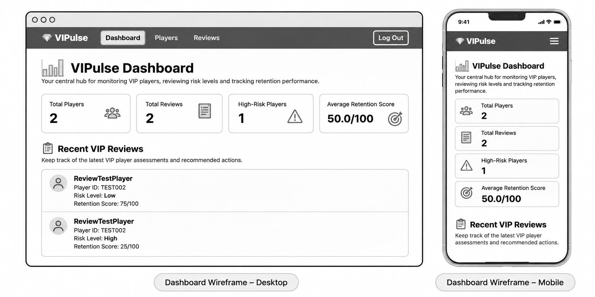

#### Player Management Wireframe

The player management layout includes player search, VIP tier filtering, player records and management actions.

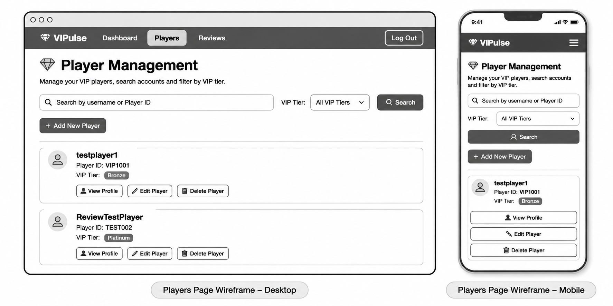

#### Player Profile Wireframe

The player profile layout brings together individual player details, summary information and historical reviews.

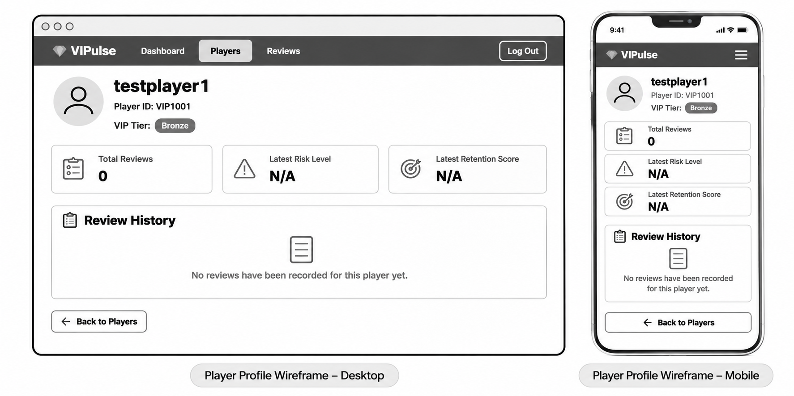

#### Review Management Wireframe

The review management layout provides access to recorded assessments, filtering controls and review management actions.

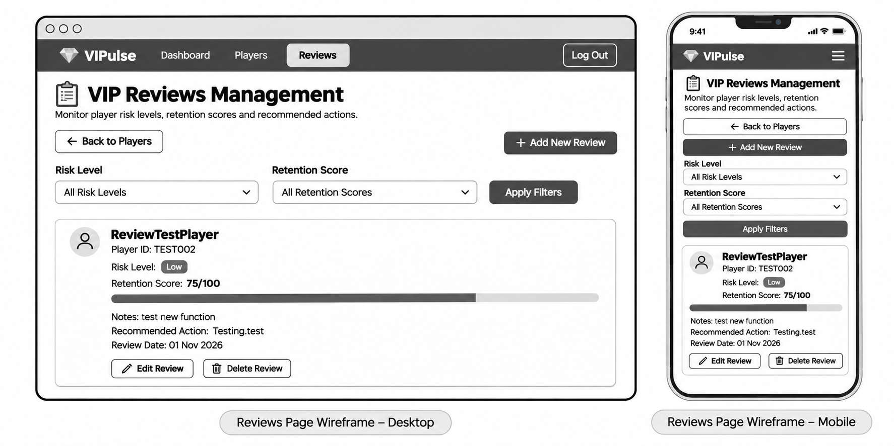

#### Player Form Wireframe

The player form layout supports both creating and editing player records through a consistent interface.

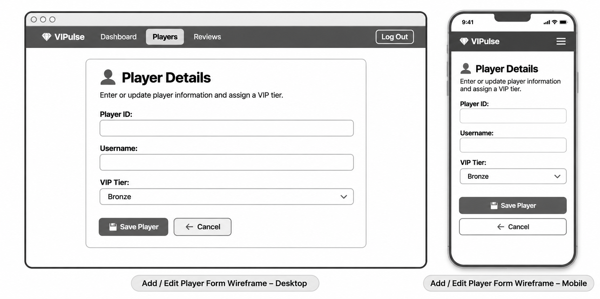

#### Review Form Wireframe

The review form layout supports entering and updating risk levels, retention scores, notes and recommended actions.

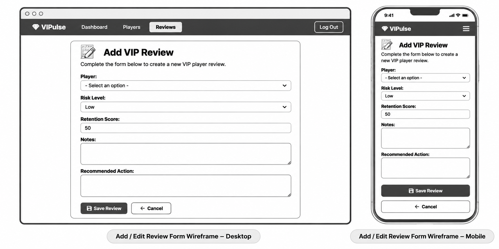

#### Login Wireframe

The login layout provides a simple authentication interface with clearly labelled username and password fields.

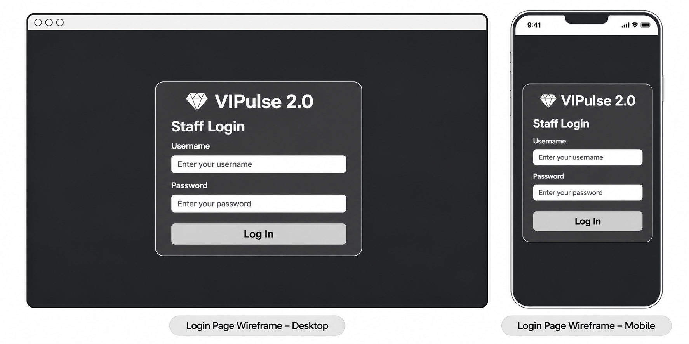

### Colour Scheme and Typography

VIPulse 2.0 uses a dark-themed interface to create a consistent visual identity across its pages.

The design uses contrasting text, clearly defined content areas and visual indicators to distinguish navigation, actions and important player information.

Typography and spacing are applied consistently to maintain readability and support a clear information hierarchy.

The interface combines Bootstrap styling with custom CSS to provide a cohesive appearance across desktop and mobile devices.

## UX Design

VIPulse 2.0 was designed with a focus on clarity, usability and efficient navigation for internal VIP management and retention teams.

The interface aims to make player information and retention assessments easy to access, while keeping common management tasks straightforward.

### Design Approach

The application's design follows several key principles:

- **Clear navigation:** Authenticated users can move between the Dashboard, Players and Reviews sections.
- **Consistent layouts:** Player and review pages use familiar cards, forms and action buttons.
- **Visual hierarchy:** Headings, statistics and status indicators help users identify important information.
- **Responsive design:** Layouts adapt to desktop and mobile screen sizes.
- **Form usability:** Clearly labelled fields and validation messages support accurate data entry.
- **Confirmation before deletion:** Users must confirm destructive actions before records are removed.

Bootstrap 5 was used to support responsive layouts and consistent interface components, alongside custom CSS for the application's visual identity.

### Wireframes

The following wireframes illustrate the page structure, visual hierarchy and responsive layouts of VIPulse 2.0 across desktop and mobile screen sizes.

#### Dashboard Wireframe

The dashboard layout presents key player and review statistics alongside recent VIP review activity.

#### Player Management Wireframe

The player management layout includes player search, VIP tier filtering, player records and management actions.

#### Player Profile Wireframe

The player profile layout brings together individual player details, summary information and historical reviews.

#### Review Management Wireframe

The review management layout provides access to recorded assessments, filtering controls and review management actions.

#### Player Form Wireframe

The player form layout supports both creating and editing player records through a consistent interface.

#### Review Form Wireframe

The review form layout supports entering and updating risk levels, retention scores, notes and recommended actions.

#### Login Wireframe

The login layout provides a simple authentication interface with clearly labelled username and password fields.

### Colour Scheme and Typography

VIPulse 2.0 uses a dark-themed interface to create a consistent visual identity across its pages.

The design uses contrasting text, clearly defined content areas and visual indicators to distinguish navigation, actions and important player information.

Typography and spacing are applied consistently to maintain readability and support a clear information hierarchy.

The interface combines Bootstrap styling with custom CSS to provide a cohesive appearance across desktop and mobile devices.

## Features

VIPulse 2.0 provides a collection of features designed to support VIP player management, retention assessments and day-to-day operational workflows.

All player management, review management and dashboard features require authentication.

### Authentication and Access Control

**Related User Stories:** [US01 - User Login](https://github.com/Azhdakurt/vipulse-2/issues/1) and [US10 - User Logout](https://github.com/Azhdakurt/vipulse-2/issues/10)

VIPulse 2.0 uses Django's built-in authentication system to protect internal player information.

Registered staff members can log in using their username and password. Invalid credentials trigger an error message, while successful authentication allows access to the application's protected pages.

Unauthenticated visitors are redirected to the login page when attempting to access protected functionality.

A logout option allows staff to end their session securely. Once logged out, protected pages cannot be accessed without authenticating again.

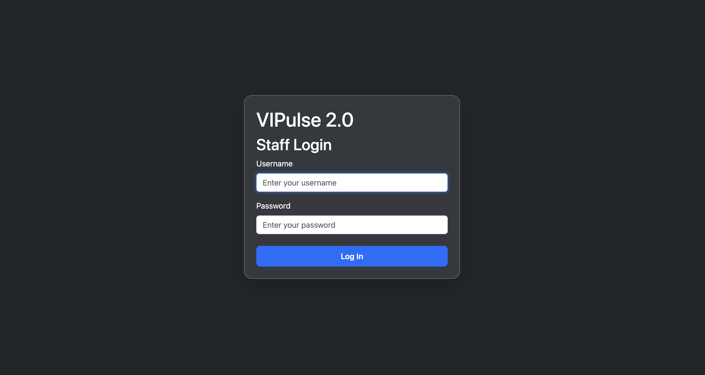

### Dashboard

**Related User Story:** [US12 - View VIP Dashboard](https://github.com/Azhdakurt/vipulse-2/issues/12)

The dashboard provides an overview of the VIP player portfolio and recorded retention assessments.

It displays four key statistics:

- **Total VIP Players:** The number of registered players.
- **Total Reviews:** The number of recorded player reviews.
- **High-Risk Players:** The number of distinct players with high-risk reviews.
- **Average Retention Score:** The average retention score across recorded reviews.

The dashboard also includes a **Recent VIP Reviews** section displaying the five most recent assessments.

These statistics are generated dynamically from the database, ensuring that the information reflects the current player and review records.

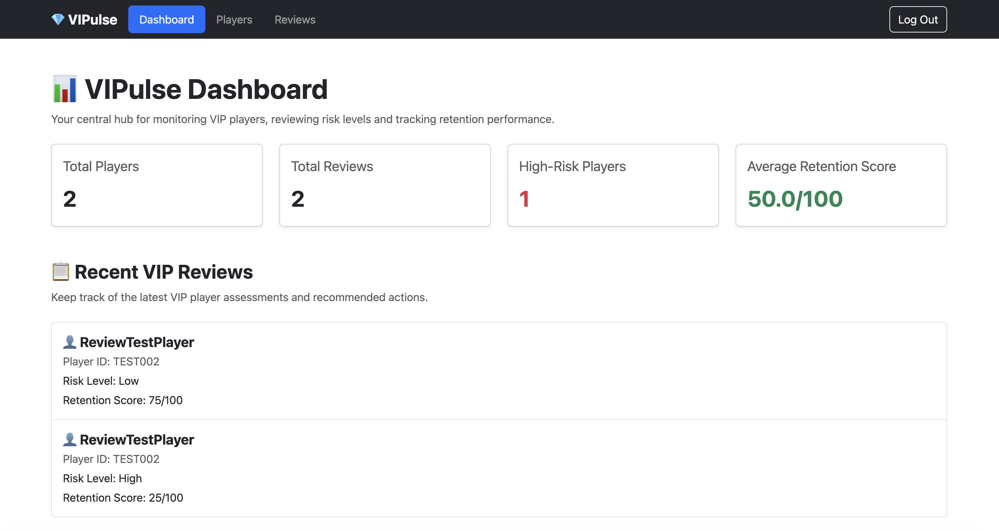

### Player Management

**Related User Stories:** [US02 - View Players](https://github.com/Azhdakurt/vipulse-2/issues/2), [US03 - Add Player](https://github.com/Azhdakurt/vipulse-2/issues/3), [US04 - Edit Player](https://github.com/Azhdakurt/vipulse-2/issues/4), [US05 - Delete Player](https://github.com/Azhdakurt/vipulse-2/issues/5), [US11 - Search Players](https://github.com/Azhdakurt/vipulse-2/issues/11) and [US13 - Filter Players by VIP Tier](https://github.com/Azhdakurt/vipulse-2/issues/13)

The Players page provides a central location for managing VIP player records.

Each player record displays identifying information, including the Player ID, username and VIP tier.

Staff members can:

- View existing player records.
- Search for players by Player ID or username.
- Filter players by Bronze, Silver, Gold, Platinum or Diamond VIP tier.
- Add new player records.
- Edit existing player information.
- Delete player records following confirmation.
- Open an individual player's profile.

Player information is retrieved dynamically from the database.

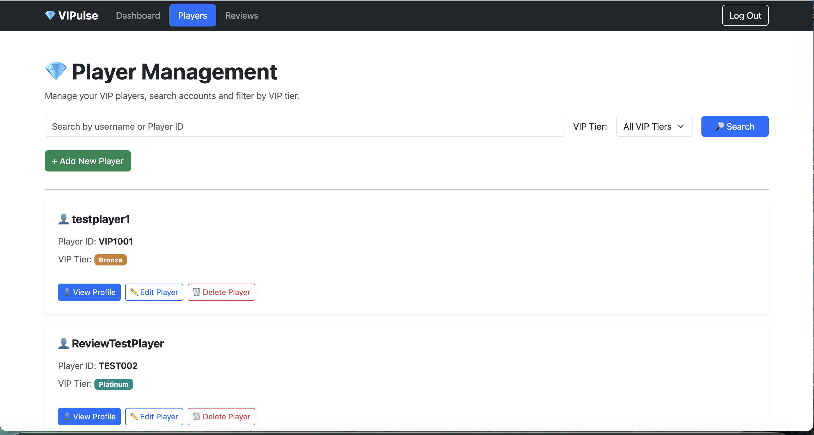

#### Adding and Editing Players

The player form allows staff to enter or update the following information:

- Player ID
- Username
- VIP Tier

Required fields are validated before submission, and duplicate Player IDs are rejected.

When editing an existing player, the form is populated with the player's current information.

After successful submission, the saved information is displayed in the player list.

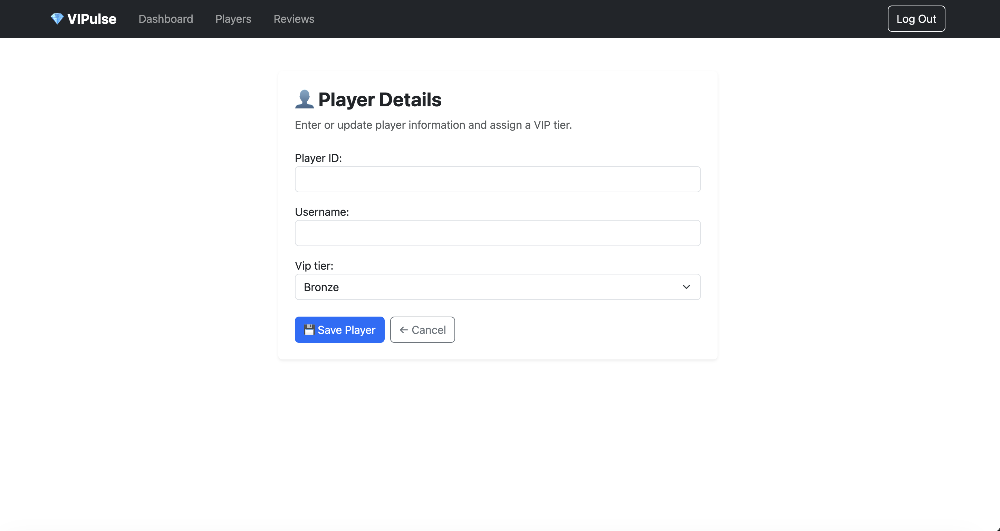

#### Deleting Players

Deleting a player requires confirmation to reduce the risk of accidental data loss.

Users can cancel the operation without changing the player record.

Once deletion is confirmed, the player is removed from the database. Associated reviews are also deleted because the Review model uses a cascading foreign key relationship.

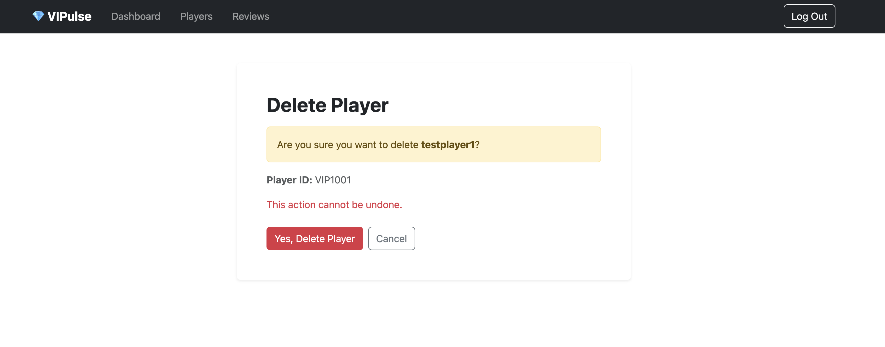

### Player Profiles

**Related User Story:** [US14 - View Individual Player Profile](https://github.com/Azhdakurt/vipulse-2/issues/14)

The individual player profile provides a consolidated view of a player's information and review history.

Staff members can access a profile directly from the Players page.

Each profile displays:

- Player ID, username and VIP tier.
- Total number of recorded reviews.
- Latest recorded risk level.
- Latest retention score.
- Previous reviews, ordered from newest to oldest.

This allows staff to review a player's recorded assessments without searching through the complete review list.

The profile also provides access to relevant review management actions.

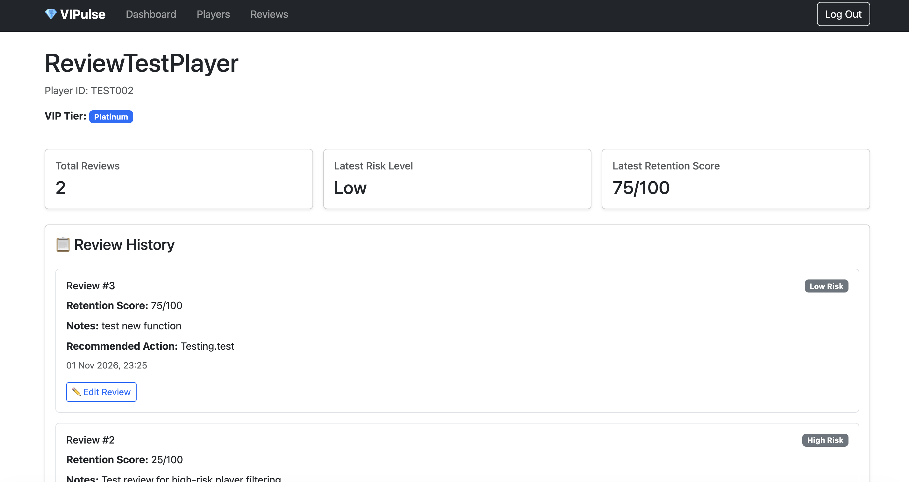

### Review Management

**Related User Stories:** [US06 - Add Review](https://github.com/Azhdakurt/vipulse-2/issues/6), [US07 - View Reviews](https://github.com/Azhdakurt/vipulse-2/issues/7), [US08 - Edit Review](https://github.com/Azhdakurt/vipulse-2/issues/8) and [US09 - Delete Review](https://github.com/Azhdakurt/vipulse-2/issues/9)

The Reviews page provides a centralised interface for managing VIP player assessments.

Each review is linked to an existing player and records:

- Risk Level
- Retention Score
- Notes
- Recommended Action

Staff can view, create, update and delete reviews.

The page also includes filtering options to help users locate relevant assessments.

**Risk Level Filter**

Reviews can be filtered by Low, Medium or High risk level.

**Retention Score Filter**

Reviews can be filtered using the following score ranges:

- Low: 0–39
- Medium: 40–69
- High: 70–100

These filters help staff focus on specific groups of recorded assessments.

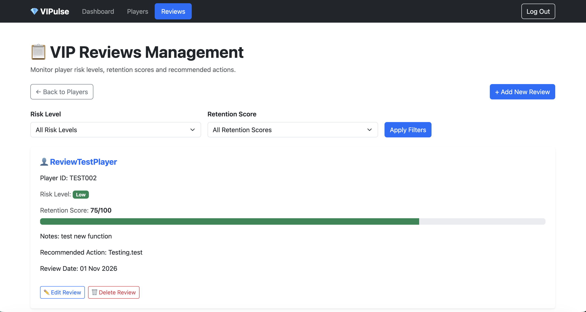

#### Adding and Editing Reviews

The review form allows staff to select an existing player and record their assessment.

The form includes:

- Player selection
- Risk Level: Low, Medium or High
- Retention Score: 0–100
- Notes
- Recommended Action

Required fields are validated, and the retention score must be within the permitted range.

When editing a review, the form displays the existing information so that staff can update the assessment.

Successfully saved reviews are stored in the database and remain associated with the selected player.

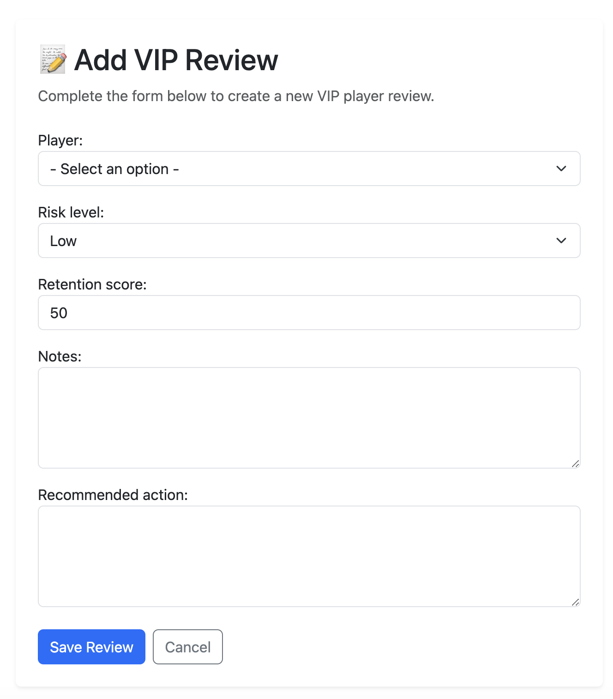

#### Deleting Reviews

Existing reviews can be deleted after confirmation.

Cancelling the confirmation leaves the review unchanged.

Deleting a review removes only that assessment and does not delete the associated player record.

### Forms and Validation

VIPulse 2.0 uses Django ModelForms to manage player and review data.

Validation helps maintain accurate and consistent records by checking:

- Required form fields.
- Unique Player IDs.
- Valid VIP tier selections.
- Valid risk level selections.
- Retention scores within the 0–100 range.

Validation feedback is displayed when submitted information does not meet the required conditions.

The application also uses confirmation pages for destructive actions, allowing users to cancel before deleting records.

Together, these features support reliable data entry and safer record management.

