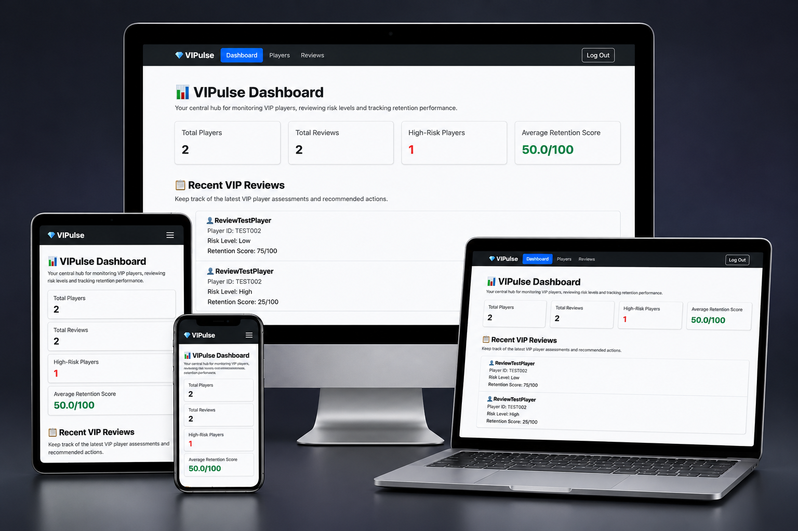
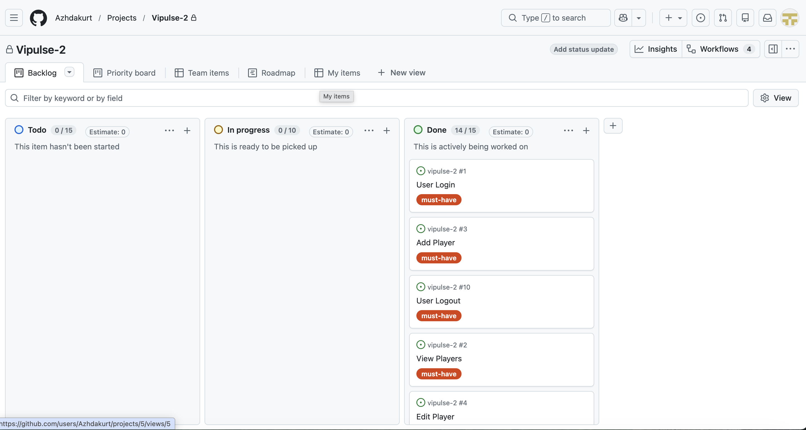

# 💎 VIPulse 2.0

**VIP Player Management and Retention Review System**

VIPulse 2.0 is a full-stack web application developed to help iGaming customer support, VIP management and retention teams organise player information, assess player risk levels and document retention recommendations.

Built using Django and PostgreSQL, the application provides a centralised workspace where authorised users can manage VIP player profiles, create and update player reviews, monitor retention scores and access key operational statistics through a dashboard.

The project focuses on structured record management, clear navigation, responsive design and practical workflows for internal operational teams.

**[Live Application](https://vipulse-2-27dcf5edfa12.herokuapp.com/)** | **[GitHub Repository](https://github.com/Azhdakurt/vipulse-2)**

*VIPulse 2.0 responsive presentation illustrating the application's desktop and mobile layouts.*

---

## Table of Contents

1. [Project Overview](#project-overview)
2. [Project Goals](#project-goals)
3. [Target Audience](#target-audience)
4. [User Stories and MoSCoW Prioritisation](#user-stories-and-moscow-prioritisation)
5. [Agile Methodology](#agile-methodology)
   - [GitHub Projects Kanban Board](#github-projects-kanban-board)
6. [UX Design](#ux-design)
   - [Design Approach](#design-approach)
   - [Wireframes](#wireframes)
   - [Colour Scheme and Typography](#colour-scheme-and-typography)
7. [Features](#features)
   - [Authentication and Access Control](#authentication-and-access-control)
   - [Dashboard](#dashboard)
   - [Player Management](#player-management)
   - [Player Profiles](#player-profiles)
   - [Review Management](#review-management)
   - [Forms and Validation](#forms-and-validation)
8. [Database Design](#database-design)
   - [Entity Relationship Diagram](#entity-relationship-diagram)
   - [Database Models](#database-models)
9. [Technologies Used](#technologies-used)
10. [Testing and Validation](#testing-and-validation)
11. [Deployment](#deployment)
    - [Local Deployment](#local-deployment)
    - [Heroku Deployment](#heroku-deployment)
12. [Bugs and Known Issues](#bugs-and-known-issues)
13. [Credits and Acknowledgements](#credits-and-acknowledgements)
14. [AI Assistance](#ai-assistance)

---

## Project Overview

VIP and retention teams often need to manage player records, review risk indicators and track recommended actions across multiple accounts. Without a structured system, this information can become difficult to organise, retrieve and maintain consistently.

VIPulse 2.0 addresses this challenge by providing a single application for player management and review tracking.

The application allows authenticated staff to:

- Create, view, update and delete VIP player records.
- Search for players using their username or Player ID.
- Filter player records by VIP tier.
- Create, edit and delete player reviews.
- Record risk levels, retention scores, notes and recommended actions.
- Filter reviews by risk level and retention score range.
- View individual player profiles and review histories.
- Monitor player and review statistics through a central dashboard.

VIPulse 2.0 is an internal staff-facing application. Authentication is required to access the dashboard, player records and review management features. Public self-registration is not available.

The application is designed as a portfolio project demonstrating full-stack development, relational database modelling, CRUD functionality, authentication, responsive user interfaces and software testing.

## Project Goals

The primary goals of VIPulse 2.0 are to:

1. Provide a centralised system for managing VIP player information.
2. Support consistent recording and review of player risk and retention assessments.
3. Make player records and review histories easy to search and access.
4. Present key operational information through a clear dashboard.
5. Protect internal application features through user authentication.
6. Deliver a responsive interface that works across different screen sizes.
7. Demonstrate full-stack development using Django and a relational database.

## Target Audience

VIPulse 2.0 is designed for internal operational teams working in the iGaming industry, including:

- **VIP Managers:** To review player profiles, VIP tiers and retention assessments.
- **Customer Support Teams:** To access structured player information and review histories.
- **Retention Teams:** To document retention scores, observations and recommended actions.
- **Team Leaders and Operations Managers:** To monitor player and review activity through the dashboard.

The application is a demonstration system rather than a production gambling platform. It does not process bets, payments or real-money transactions.

## User Stories and MoSCoW Prioritisation

User stories were created to define the application's functional requirements from the perspective of its intended users. Each story describes a specific user need and the value that the corresponding feature should provide.

The project was planned and managed using GitHub Issues and GitHub Projects. Each user story includes acceptance criteria and development tasks to support implementation and testing.

The MoSCoW prioritisation method was used to organise the requirements according to their importance.

- **Must Have:** Essential functionality required for the application to operate effectively.
- **Should Have:** Important functionality that improves the user experience and supports operational workflows.
- **Could Have:** Additional functionality that enhances usability but is not essential to the core application.
- **Won't Have:** Functionality excluded from the current project scope.

### Must Have User Stories

| ID | User Story | GitHub Issue |
| --- | --- | --- |
| US01 | As a registered staff member, I want to log in securely to VIPulse, so that I can access the player management system and manage VIP player information. | [#1 - User Login](https://github.com/Azhdakurt/vipulse-2/issues/1) |
| US02 | As a staff member, I want to view a list of registered VIP players, so that I can access and manage their player information efficiently. | [#2 - View Players](https://github.com/Azhdakurt/vipulse-2/issues/2) |
| US03 | As a staff member, I want to add new VIP players to the system, so that I can maintain accurate player records and manage their VIP information. | [#3 - Add Player](https://github.com/Azhdakurt/vipulse-2/issues/3) |
| US04 | As a staff member, I want to edit existing VIP player information, so that I can keep player records accurate and up to date. | [#4 - Edit Player](https://github.com/Azhdakurt/vipulse-2/issues/4) |
| US05 | As a staff member, I want to delete an existing VIP player record, so that I can remove records that are no longer required and keep the player database accurate. | [#5 - Delete Player](https://github.com/Azhdakurt/vipulse-2/issues/5) |
| US06 | As a VIP team member, I want to create a review for an existing player, so that I can assess their retention status, identify potential risks and recommend appropriate actions. | [#6 - Add Review](https://github.com/Azhdakurt/vipulse-2/issues/6) |
| US07 | As a VIP team member, I want to view all player reviews in one place, so that I can monitor player retention, identify potential risks and review recommended actions. | [#7 - View Reviews](https://github.com/Azhdakurt/vipulse-2/issues/7) |
| US08 | As a VIP team member, I want to edit an existing player review, so that I can update risk assessments, retention scores and recommended actions as a player's circumstances change. | [#8 - Edit Review](https://github.com/Azhdakurt/vipulse-2/issues/8) |
| US09 | As a VIP team member, I want to delete an existing player review, so that I can remove incorrect or unnecessary assessments and maintain accurate review records. | [#9 - Delete Review](https://github.com/Azhdakurt/vipulse-2/issues/9) |
| US10 | As a logged-in staff member, I want to log out securely from VIPulse, so that I can end my session and prevent unauthorised access to player information. | [#10 - User Logout](https://github.com/Azhdakurt/vipulse-2/issues/10) |

### Should Have User Stories

| ID | User Story | GitHub Issue |
| --- | --- | --- |
| US11 | As a VIP team member, I want to search for players by Player ID or username, so that I can quickly locate specific player records without manually browsing the entire player list. | [#11 - Search Players](https://github.com/Azhdakurt/vipulse-2/issues/11) |
| US12 | As a VIP team member, I want to view a dashboard summarising player and retention review data, so that I can quickly understand the VIP portfolio, identify potential risks and make informed retention decisions. | [#12 - View VIP Dashboard](https://github.com/Azhdakurt/vipulse-2/issues/12) |
| US14 | As a VIP team member, I want to view an individual player's profile, including their VIP tier, latest risk level, retention score and review history, so that I can quickly understand their current status and make informed retention decisions. | [#14 - View Individual Player Profile](https://github.com/Azhdakurt/vipulse-2/issues/14) |

### Could Have User Stories

| ID | User Story | GitHub Issue |
| --- | --- | --- |
| US13 | As a VIP team member, I want to filter players by their VIP tier, so that I can quickly identify players within a specific VIP segment and manage them more efficiently. | [#13 - Filter Players by VIP Tier](https://github.com/Azhdakurt/vipulse-2/issues/13) |

### User Story Implementation

All 14 user stories were implemented in VIPulse 2.0.

The completed functionality includes secure authentication, player and review CRUD operations, player searching, VIP tier filtering, dashboard statistics and individual player profiles.

Each GitHub Issue contains its associated acceptance criteria and implementation tasks, providing a record of the requirements and development work.

Functional testing and validation are documented separately in [TESTING.md](TESTING.md).

The user stories were tracked through the project's GitHub Kanban board, which is discussed in the following Agile Methodology section.

## Agile Methodology

VIPulse 2.0 was developed using an Agile approach, with project requirements organised into user stories and tracked through GitHub Projects.

Each user story was documented as a GitHub Issue, including acceptance criteria and development tasks. The MoSCoW prioritisation method was used to distinguish essential functionality from additional improvements.

### GitHub Projects Kanban Board

A GitHub Projects Kanban board was used to organise and monitor development progress.

The board included three workflow stages:

- **To Do:** User stories and tasks awaiting development.
- **In Progress:** Features currently being implemented or tested.
- **Done:** Features that had been completed.

*VIPulse 2.0 Kanban board showing the project's development workflow and user story progress.*

The board can be viewed here:

[View VIPulse 2.0 GitHub Project Board](https://github.com/users/Azhdakurt/projects/5/views/1)

This approach helped organise the development process, prioritise essential functionality and track the implementation of the application's 14 user stories.

