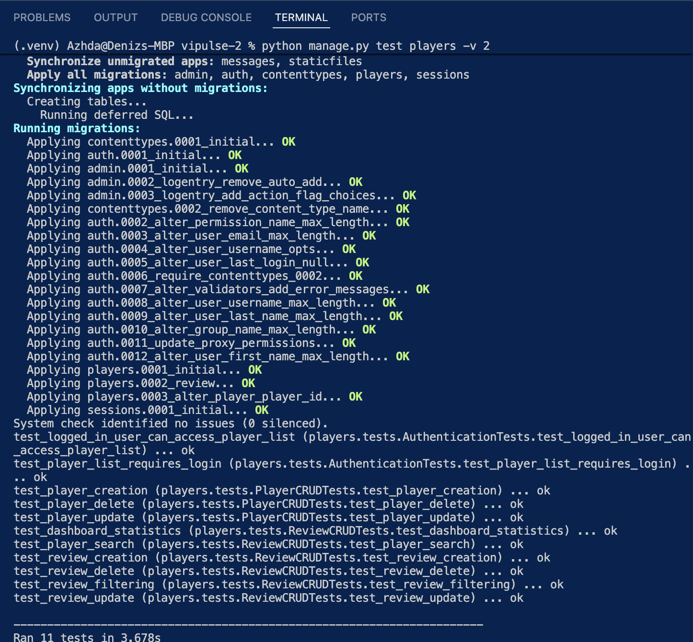
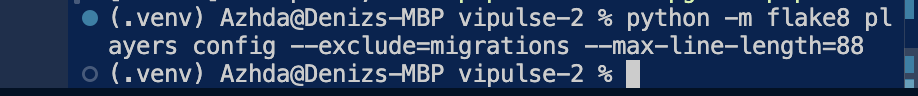
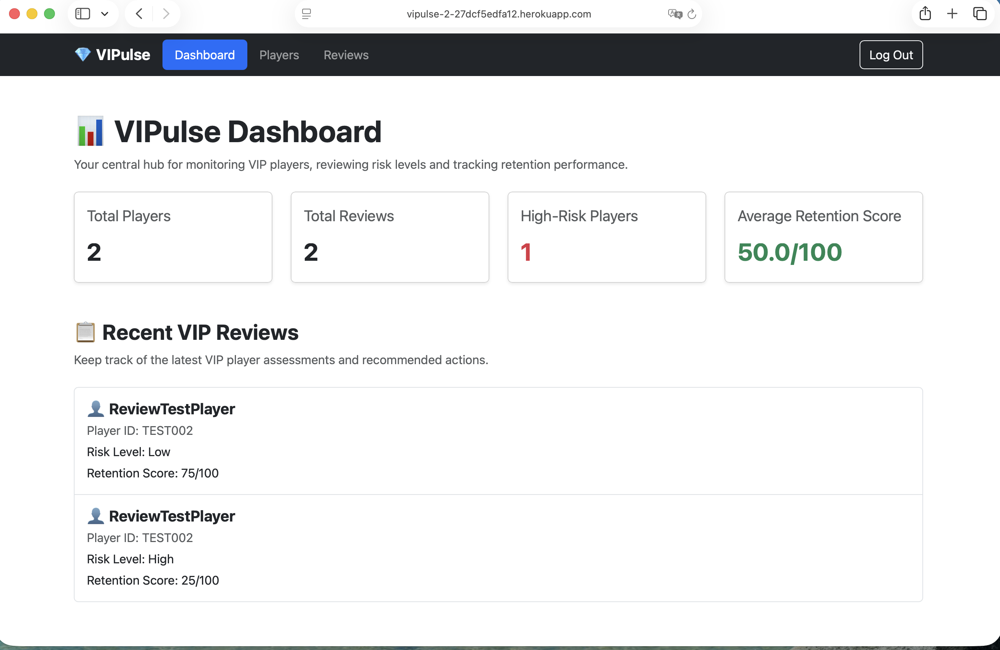
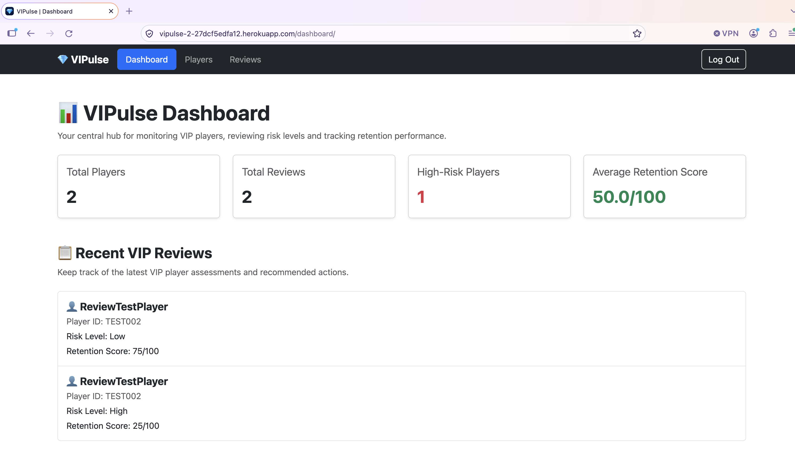

# VIPulse 2.0 — Testing Documentation

## 1. Introduction

This document outlines the testing procedures carried out for VIPulse 2.0, a Django-based player management and review application developed as part of the Code Institute Level 5 Web Applications Development programme.

Testing was conducted to assess the application's functionality, usability, accessibility, responsiveness, code quality and security configuration.

The testing process included:

- Automated Django unit and integration tests.
- Manual functional testing of authentication, player management, review management, search and filtering.
- Responsive design testing across mobile and desktop screen sizes.
- HTML validation using the W3C Nu HTML Checker.
- CSS validation using the W3C CSS Validation Service.
- Python code quality checks using Flake8.
- Django system and deployment configuration checks.
- Google Lighthouse audits for performance, accessibility, best practices and SEO.

Testing was performed using the locally running Django application and the deployed Heroku application.

The following sections document the testing methods, results, supporting evidence, identified issues and resolutions.

## 2. Automated Django Tests

Automated tests were implemented using Django's built-in testing framework to verify the application's core functionality.

The tests cover authentication, player management, review management, search, filtering and dashboard statistics.

### Running the Tests

From the project's root directory, with the virtual environment activated, run:

```bash
python manage.py test players -v 2
```

### Test Results

**Result: 11 tests passed successfully.**

The automated test suite verifies the following functionality:

| Test Area | Functionality Tested | Result |
|---|---|---|
| Authentication | Unauthenticated users are redirected to the login page when accessing protected views. | Pass |
| Authentication | Authenticated users can access protected application pages. | Pass |
| Player Management | A new player can be created successfully. | Pass |
| Player Management | Existing player details can be updated. | Pass |
| Player Management | Players can be deleted successfully. | Pass |
| Review Management | A new review can be created and linked to a player. | Pass |
| Review Management | Existing reviews can be updated. | Pass |
| Review Management | Reviews can be deleted successfully. | Pass |
| Player Search | Players can be searched using the supported search functionality. | Pass |
| Review Filtering | Reviews can be filtered by risk level. | Pass |
| Dashboard | Dashboard statistics are calculated and displayed using the expected context values. | Pass |

All 11 automated tests completed successfully without failures or errors.

### Evidence



The screenshot above shows the successful execution of the automated Django test suite.

## 3. Manual Functional Testing

Manual testing was carried out to verify the application's functionality from an end-user perspective.

The deployed Heroku application was tested using a regular authenticated user account to verify that core features were accessible without administrator privileges.

### 3.1 Authentication and Access

| Test ID | Test Steps | Expected Result | Actual Result | Status |
|---|---|---|---|---|
| MT-01 | Open the deployed application and log in using a valid user account. | The user can access the authenticated application. | Login was successful and the application was accessible. | Pass |
| MT-02 | Access the application using a regular account without staff or superuser permissions. | Core application features remain accessible to authenticated users. | Core functionality was accessible using a regular account. | Pass |

### 3.2 Player Management

| Test ID | Test Steps | Expected Result | Actual Result | Status |
|---|---|---|---|---|
| MT-03 | Create a new player using the Add Player form. | The player is saved and appears in the application. | The player was created successfully. | Pass |
| MT-04 | Open an existing player and update their details. | Updated information is saved correctly. | Player details were updated successfully. | Pass |
| MT-05 | Delete a test player using the confirmation page. | The selected player is removed from the application. | The test player was deleted successfully. | Pass |
| MT-06 | Open a player profile without any reviews. | Review-related information displays an appropriate empty state. | The profile displayed N/A for unavailable review information. | Pass |
| MT-07 | Open a player profile containing multiple reviews. | The latest review is identified correctly and reviews appear in descending date order. | The latest review information was displayed and the newest review appeared first. | Pass |

### 3.3 Review Management

| Test ID | Test Steps | Expected Result | Actual Result | Status |
|---|---|---|---|---|
| MT-08 | Create a review for an existing player. | The review is saved and associated with the selected player. | The review was created successfully. | Pass |
| MT-09 | Edit a review from a player's profile and save the changes. | The changes are saved and the user returns to the player profile. | The review was updated and the user returned to the profile. | Pass |
| MT-10 | Open the Edit Review page from a player profile and select Cancel. | No changes are saved and the user returns to the player profile. | The user returned to the profile without saving changes. | Pass |
| MT-11 | Delete a test review using the confirmation page. | The selected review is removed. | The review was deleted successfully. | Pass |

### 3.4 Responsive Navigation

| Test ID | Test Steps | Expected Result | Actual Result | Status |
|---|---|---|---|---|
| MT-12 | View the Dashboard at a mobile viewport width of 375px. | Content remains usable without horizontal overflow. | No horizontal overflow was observed. | Pass |
| MT-13 | View the Player List at a mobile viewport width of 375px. | Content remains usable without horizontal overflow. | No horizontal overflow was observed. | Pass |
| MT-14 | View the Review List at a mobile viewport width of 375px. | Content remains usable without horizontal overflow. | No horizontal overflow was observed. | Pass |

### 3.5 Search and Filtering

The following tests were performed manually on the deployed Heroku application to verify search functionality, filtering behaviour and empty-state messages.

| Test ID | Test Steps | Expected Result | Actual Result | Status |
|---|---|---|---|---|
| MT-15 | Search for an existing player using part of their username. | Players with matching usernames are displayed. | Matching players were displayed correctly when searching for `tes`. | Pass |
| MT-16 | Search for a player using a term that does not exist. | An appropriate no-results message is displayed. | The message `No players found matching "zumba".` was displayed. | Pass |
| MT-17 | Select a VIP tier containing existing players. | Only players belonging to the selected VIP tier are displayed. | Players were filtered correctly by VIP tier. | Pass |
| MT-18 | Select a VIP tier without any matching players. | An empty-state message is displayed. | The message `No players have been added yet.` was displayed. | Pass |
| MT-19 | Filter reviews by High, Medium and Low risk levels. | Only reviews matching the selected risk level are displayed. | All three risk-level filters returned the expected results. | Pass |
| MT-20 | Select All Risk Levels. | All reviews are displayed. | All reviews were displayed correctly. | Pass |
| MT-21 | Select a risk level without matching reviews. | A clear no-results message is displayed. | The message `No reviews match your selected filters. Try adjusting your filters.` was displayed. | Pass |
| MT-22 | Filter reviews by Low (0–39), Medium (40–69) and High (70–100) retention scores. | Only reviews within the selected score range are displayed. | All three retention-score filters returned the expected results. | Pass |
| MT-23 | Select All Scores. | All reviews are displayed regardless of retention score. | All reviews were displayed correctly. | Pass |
| MT-24 | Select a retention-score range without matching reviews. | An appropriate no-results message is displayed. | The message `No reviews match your selected filters. Try adjusting your filters.` was displayed. | Pass |

**Observation:** When a VIP tier contains no matching players, the Player List displays `No players have been added yet.` Although the filtering functionality works correctly, this message could be more specific to the selected filter. This is documented as a minor usability issue.

### 3.6 Form Validation

Manual validation testing was performed on the deployed Heroku application to verify that invalid or incomplete form submissions are prevented and appropriate feedback is displayed.

| Test ID | Test Steps | Expected Result | Actual Result | Status |
|---|---|---|---|---|
| MT-25 | Submit the Add Player form with Player ID and Username left empty. | The form is not submitted and required-field validation is displayed. | Submission was prevented and the browser displayed `Please fill in this field.` | Pass |
| MT-26 | Attempt to create a player using an existing Player ID. | Duplicate Player IDs are rejected. | Submission was rejected with `Player with this Player ID already exists.` | Pass |
| MT-27 | Enter `101` as the Retention Score when creating a review. | Values above 100 are rejected. | Submission was prevented and the browser displayed `Value must be less than or equal to 100.` | Pass |
| MT-28 | Enter `-1` as the Retention Score when creating a review. | Negative values are rejected. | Submission was prevented and the browser displayed `Value must be greater than or equal to 0.` | Pass |

These tests confirmed that the tested forms enforce required fields, prevent duplicate player identifiers and restrict retention scores to the permitted range of 0–100.

Required-field and numeric range validation feedback was provided through the browser's native form validation, while duplicate Player ID validation was displayed by the application.

## 4. HTML Validation

HTML validation was performed using the [W3C Nu HTML Checker](https://validator.w3.org/nu/) to assess the quality and standards compliance of the application's rendered HTML.

All 11 application pages were validated. Each page returned zero errors and zero warnings.

### Validation Results

| Page | Errors | Warnings | Result | Evidence |
|---|---:|---:|---|---|
| Dashboard | 0 | 0 | Pass | [Screenshot](docs/dashboard-html-validation.png) |
| Player List | 0 | 0 | Pass | [Screenshot](docs/players-html-validation.png) |
| Player Profile | 0 | 0 | Pass | [Screenshot](docs/player-profile-html-validation.png) |
| Review List | 0 | 0 | Pass | [Screenshot](docs/reviews-html-validation.png) |
| Add Player | 0 | 0 | Pass | [Screenshot](docs/add-player-html-validation.png) |
| Edit Player | 0 | 0 | Pass | [Screenshot](docs/edit-player-html-validation.png) |
| Delete Player | 0 | 0 | Pass | [Screenshot](docs/delete-player-html-validation.png) |
| Add Review | 0 | 0 | Pass | [Screenshot](docs/add-review-html-validation.png) |
| Edit Review | 0 | 0 | Pass | [Screenshot](docs/edit-review-html-validation.png) |
| Delete Review | 0 | 0 | Pass | [Screenshot](docs/delete-review-html-validation.png) |
| Login | 0 | 0 | Pass | [Screenshot](docs/login-html-validation.png) |

### Summary

All 11 tested pages passed HTML validation without errors or warnings.

The validation process also helped identify and resolve markup issues before the final checks were completed.

## 5. CSS Validation

CSS validation was performed using the [W3C CSS Validation Service](https://jigsaw.w3.org/css-validator/) to check selected custom CSS rules for syntax errors and compliance with CSS standards.

### Validation Results

| CSS Component | Errors | Result | Evidence |
|---|---:|---|---|
| Player List — Custom Badge Styling | 0 | Pass | [Screenshot](docs/player-list-css-validation.png) |
| Login Page — Custom Layout Styling | 0 | Pass | [Screenshot](docs/login-css-validation.png) |

### Summary

Both tested CSS components passed validation with zero errors.

These checks covered selected custom CSS rules rather than a complete validation of every stylesheet and inline style used throughout the application.

The application also uses Bootstrap 5.3.3 for its responsive layout and interface components.

## 6. Python Code Quality and Django System Checks

Python code quality and Django configuration checks were performed to identify potential issues before submission.

### 6.1 Flake8 Validation

Flake8 was used to check the Python code in the `players` and `config` directories for style and formatting issues.

The following command was executed from the project root:

```bash
python -m flake8 players config --exclude=migrations --max-line-length=88
```

**Result: Pass**

The command completed without reporting any violations.

**Evidence:**



### 6.2 Django System Check

Django's built-in system check framework was used to identify configuration and application issues.

Command:

```bash
python manage.py check
```

**Result: Pass**

The command returned:

```text
System check identified no issues (0 silenced).
```

### 6.3 Django Deployment Security Check

A deployment-oriented configuration check was performed with debug mode disabled:

```bash
DEBUG=False python manage.py check --deploy
```

**Result: Completed with two warnings and no errors.**

The remaining warnings were:

| Warning | Description | Explanation |
|---|---|---|
| security.W005 | `SECURE_HSTS_INCLUDE_SUBDOMAINS` is not set to `True`. | Subdomain-wide HSTS enforcement was not enabled because the application uses a Heroku-provided domain rather than a custom domain under the project's control. |
| security.W021 | `SECURE_HSTS_PRELOAD` is not set to `True`. | HSTS preloading was not enabled for the Heroku-provided domain. |

The application uses conditional security settings for HTTPS redirection and secure session and CSRF cookies when `DEBUG=False`.

The HSTS duration was configured to 300 seconds in non-debug mode.

The deployment check was performed locally using production-style settings. It does not, by itself, verify every environment variable or configuration value on the deployed Heroku application.

### Summary

The Python code passed the Flake8 checks, and the standard Django system check reported no issues.

The deployment security check reported no errors and two documented HSTS-related warnings.

## 7. Google Lighthouse Testing

Google Lighthouse audits were performed on the deployed Heroku application using Chrome DevTools.

Each of the 11 application pages was tested in both Mobile and Desktop modes, resulting in **22 Lighthouse audits**.

The audits evaluated four categories:

- **Performance:** Page loading and rendering performance.
- **Accessibility:** Automated checks for common accessibility issues.
- **Best Practices:** General web development best practices.
- **SEO:** Search engine optimisation checks.

### 7.1 Lighthouse Results

All scores are out of 100.

| Page | Device | Performance | Accessibility | Best Practices | SEO |
|---|---|---:|---:|---:|---:|
| Dashboard | Mobile | 98 | 100 | 100 | 90 |
| Dashboard | Desktop | 100 | 100 | 100 | 90 |
| Player List | Mobile | 98 | 95 | 100 | 90 |
| Player List | Desktop | 100 | 95 | 100 | 90 |
| Player Profile | Mobile | 98 | 100 | 100 | 90 |
| Player Profile | Desktop | 100 | 100 | 100 | 90 |
| Review List | Mobile | 98 | 100 | 100 | 90 |
| Review List | Desktop | 100 | 100 | 100 | 90 |
| Add Player | Mobile | 98 | 100 | 100 | 90 |
| Add Player | Desktop | 100 | 100 | 100 | 90 |
| Edit Player | Mobile | 98 | 100 | 100 | 90 |
| Edit Player | Desktop | 100 | 100 | 100 | 90 |
| Delete Player | Mobile | 98 | 100 | 100 | 90 |
| Delete Player | Desktop | 100 | 100 | 100 | 90 |
| Add Review | Mobile | 98 | 100 | 100 | 90 |
| Add Review | Desktop | 100 | 100 | 100 | 90 |
| Edit Review | Mobile | 98 | 100 | 100 | 90 |
| Edit Review | Desktop | 100 | 100 | 100 | 90 |
| Delete Review | Mobile | 98 | 100 | 100 | 90 |
| Delete Review | Desktop | 100 | 100 | 100 | 90 |
| Login | Mobile | 98 | 100 | 100 | 90 |
| Login | Desktop | 100 | 100 | 100 | 90 |

### 7.2 Lighthouse Evidence

Screenshots of all 22 Lighthouse audits are stored in the `docs/` directory.

| Page | Mobile Evidence | Desktop Evidence |
|---|---|---|
| Dashboard | [Mobile](docs/lighthouse-dashboard-mobile.png) | [Desktop](docs/lighthouse-dashboard-desktop.png) |
| Player List | [Mobile](docs/lighthouse-players-mobile.png) | [Desktop](docs/lighthouse-players-desktop.png) |
| Player Profile | [Mobile](docs/lighthouse-player-profile-mobile.png) | [Desktop](docs/lighthouse-player-profile-desktop.png) |
| Review List | [Mobile](docs/lighthouse-reviews-mobile.png) | [Desktop](docs/lighthouse-reviews-desktop.png) |
| Add Player | [Mobile](docs/lighthouse-add-player-mobile.png) | [Desktop](docs/lighthouse-add-player-desktop.png) |
| Edit Player | [Mobile](docs/lighthouse-edit-player-mobile.png) | [Desktop](docs/lighthouse-edit-player-desktop.png) |
| Delete Player | [Mobile](docs/lighthouse-delete-player-mobile.png) | [Desktop](docs/lighthouse-delete-player-desktop.png) |
| Add Review | [Mobile](docs/lighthouse-add-review-mobile.png) | [Desktop](docs/lighthouse-add-review-desktop.png) |
| Edit Review | [Mobile](docs/lighthouse-edit-review-mobile.png) | [Desktop](docs/lighthouse-edit-review-desktop.png) |
| Delete Review | [Mobile](docs/lighthouse-delete-review-mobile.png) | [Desktop](docs/lighthouse-delete-review-desktop.png) |
| Login | [Mobile](docs/lighthouse-login-mobile.png) | [Desktop](docs/lighthouse-login-desktop.png) |

### 7.3 Lighthouse Findings

The audits produced consistently strong results across the tested pages.

- **Performance:** Mobile scores were 98, while Desktop scores were 100.
- **Accessibility:** Ten pages scored 100 in both modes. The Player List scored 95 in both modes.
- **Best Practices:** All recorded audits scored 100.
- **SEO:** All pages scored 90.

The Player List accessibility score of 95 indicates that at least one automated accessibility check requires further investigation.

The SEO score of 90 also indicates that some optimisation opportunities remain.

Lighthouse provides automated assessments and does not replace manual accessibility or usability testing.

### 7.4 Summary

The Lighthouse testing process demonstrated strong performance and consistently high automated accessibility and best-practice scores across the deployed application.

The remaining accessibility and SEO improvements are documented as areas for further investigation rather than being presented as fully resolved.

## 8. Bugs, Fixes and Known Issues

Testing and development helped identify issues affecting application behaviour, validation, usability and deployment configuration.

This section documents confirmed fixes, outstanding issues and areas requiring further investigation.

### 8.1 Resolved Issues

| Issue | Resolution | Status |
|---|---|---|
| HTML validation issues | Markup issues identified during development were corrected. All 11 tested pages subsequently passed HTML validation with zero errors and zero warnings. | Resolved |
| Django security configuration | Duplicate settings were cleaned up, secure cookie and HTTPS settings were configured conditionally for non-debug environments, and a short HSTS duration was introduced. | Resolved |
| Review navigation | The Edit Review workflow was configured to return users to the player profile when accessed from that profile. Saving and cancelling were subsequently verified manually. | Resolved |

### 8.2 Known Issues and Limitations

**KI-01 — Player List empty-state message**

When a VIP tier is selected and no players match that tier, the application displays:

`No players have been added yet.`

This message is misleading when players exist in other VIP tiers.

- **Impact:** Minor usability issue. Filtering works correctly, but the message does not accurately describe the situation.
- **Status:** Open.
- **Suggested improvement:** Display a filter-specific message such as `No players match the selected VIP tier.`

**KI-02 — Player List accessibility score**

The Player List received an Accessibility score of 95/100 in both Mobile and Desktop Lighthouse audits.

- **Impact:** An automated accessibility finding remains to be investigated.
- **Status:** Open for investigation.
- **Suggested improvement:** Review the detailed Lighthouse accessibility diagnostics and address the specific reported issue.

**KI-03 — SEO optimisation**

All tested pages received an SEO score of 90/100 in Lighthouse.

- **Impact:** Some SEO checks did not achieve a perfect score.
- **Status:** Open for investigation.
- **Suggested improvement:** Review Lighthouse SEO diagnostics to identify the exact recommendations before making changes.

### 8.3 Deployment Security Warnings

The production-style Django deployment check returned two warnings relating to HSTS subdomain coverage and preloading.

These settings were intentionally not enabled for the Heroku-provided domain. The warnings and their rationale are documented in Section 6.3.

### 8.4 Outstanding Bugs Statement

At the time of testing, the confirmed outstanding application issue was the Player List's misleading empty-state message when filtering by a VIP tier with no matching players.

The Lighthouse accessibility and SEO findings remain open for investigation. Their underlying causes have not yet been confirmed, so they are not described as diagnosed application bugs.

No additional unresolved functional bugs were identified during the documented tests. This statement applies only to the functionality and scenarios tested and does not guarantee that the application is free from defects.

## 9. Browser Compatibility and Responsive Testing

Cross-browser testing was performed to assess the application's functionality and visual consistency across different web browsers.

The deployed Heroku application was tested using Google Chrome, Apple Safari and Mozilla Firefox.

### 9.1 Browser Compatibility

| Test Area | Chrome | Safari | Firefox |
|---|---|---|---|
| Login | Pass | Pass | Pass |
| Logout | Pass | Pass | Pass |
| Dashboard layout | Pass | Pass | Pass |
| Navigation | Pass | Pass | Pass |
| Player Search | Pass | Pass | Pass |
| VIP Tier Filtering | Pass | Pass | Pass |
| Review Risk Level Filtering | Pass | Pass | Pass |
| Review Retention Score Filtering | Pass | Pass | Pass |
| Add Player form display | Pass | Pass | Pass |
| Add Review form display | Pass | Pass | Pass |

The tested functionality worked as expected in the browsers where each check was performed. No browser-specific functional issues were observed during these tests.

### 9.2 Browser Testing Evidence

The following screenshots provide visual evidence of the deployed application's desktop appearance in Safari and Firefox.

**Safari Desktop**



**Firefox Desktop**



### 9.3 Responsive Design Testing

Responsive testing was performed in Chrome using a mobile viewport width of 375px.

The following pages were manually checked:

| Page | Viewport | Expected Result | Actual Result | Status |
|---|---|---|---|---|
| Dashboard | 375px | Content remains usable without unwanted horizontal overflow. | No horizontal overflow observed. | Pass |
| Player List | 375px | Content remains usable without unwanted horizontal overflow. | No horizontal overflow observed. | Pass |
| Review List | 375px | Content remains usable without unwanted horizontal overflow. | No horizontal overflow observed. | Pass |

Additionally, all 11 application pages were assessed using Lighthouse's Mobile and Desktop audit modes. Detailed results and screenshots are provided in Section 7.

### 9.4 Testing Limitations

Browser compatibility testing focused on the core application workflows rather than repeating every manual test case in every browser.

Safari and Firefox were tested in desktop browser environments. Dedicated mobile Safari and mobile Firefox testing was not performed.

Lighthouse Mobile audits simulate mobile conditions and should not be interpreted as testing on physical mobile devices.

The results demonstrate compatibility within the tested environments but do not guarantee identical behaviour across every browser version, device or operating system.